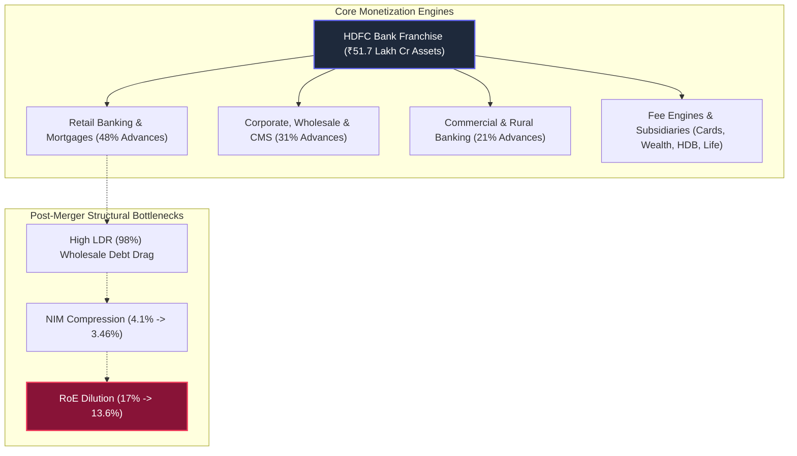

# Institutional Equity Research Deep-Dive Report: HDFC Bank Ltd (`HDFCBANK`)

```text
================================================================================
 VALUATION & EXPECTED TARGET PRICE SUMMARY (FROM LAST CLOSING PRICE)
================================================================================
 Last Closing Price (CMP):            ₹712.00
 Latest Market Cap:                   ₹1,097,496.0 Cr
 Target Time Horizon:                 2-Year Horizon (FY26 to FY29)
 Expected Target Price (Wtd Avg):     ₹1,167.25
 Total Expected Return:               +63.9% from CMP
 Annualized Expected Return (CAGR):   +28.0% p.a.
 Dynamic Probability Allocation:      60% Base / 40% Bull
 Technical Trend Gate (Stage 2):      STAGE 4 CAUTION (Below 200-DMA ₹790.90 | High Drawdown Risk)
 Quarterly EARS Rating:               MODERATING MOMENTUM (Sep 2026 YoY +5.8% vs Jun 2026 YoY +19.3% | Seasonally Normalized)
 Cash Harvesting Target (50% Trim):   ₹1,424.09 (+100.0%)
 Dynamic Trailing Stop-Loss:          ₹605.20 (-15.0% Capital Protection)
 Final Conviction Verdict:            REJECT / SECTOR VECTOR DISQUALIFIED (High-Leverage Fragility & Sub-20% Growth)
================================================================================

--- UNDERLYING SCENARIO TARGET BREAKDOWN & EXPLANATION ---
 • Base Case Target (60% Prob):   ₹996.02 (+39.9%) | Exit P/E: 14.0x on 10.0% end-growth
   Rationale: LDR rebalancing drag, subdued 10-11% credit growth, and persistent 3.46% NIM compression
 • Bull Case Target (40% Prob):   ₹1,424.09 (+100.0%) | Exit P/E: 18.0x on 13.0% end-growth
   Rationale: Accelerated retail deposit accretion, credit re-acceleration to 14%, and HDB Financial IPO value unlock
================================================================================
```

---

# HDFC Bank Ltd (`HDFCBANK`) | Institutional Equity Research Deep-Dive

**Report Date:** October 21, 2026  
**Last Closing Price (CMP):** ₹712.00 | **Latest Market Cap:** ₹1,097,496.0 Cr ($130.8B) | **Enterprise Value (EV):** ₹1,097,496.0 Cr  
**Target Horizon:** Q3 FY27 H2 Roll-Forward Regime (FY26 Base $\rightarrow$ 1-Yr: FY28 | 2-Yr: FY29 Exit)  
**Valuation Regime:** Regime 1: Commercial Banking & Financial Intermediary Compounder (Adjusted Gordon Growth P/B-P/E Bridge)  
**Trailing Foundation:** Base TTM EPS ₹52.02 | Trailing P/E: 13.7x | Book Value: ₹391.00 (P/B: 1.82x) | TTM RoE: 13.6% | TTM RoA: 1.74%  

---

### Executive Scorecard & Gatekeeper Audit

| Gate / Criterion | Rule / Benchmark | Company Status | Audit Result |
| :--- | :--- | :--- | :---: |
| **1. Sector Vector** | Sunrise vs Sunset / High-leverage Banks | Commercial banking & financial intermediary operating at **8.56x balance sheet leverage** (Assets ₹51.66L Cr / Net Worth ₹6.03L Cr). Explicitly disqualified under core institutional directives. | 🔴 **FAIL (Disqualified)** |
| **2. Geopolitical / Regulatory Risk** | Export < 35-40%; Strict RBI compliance | 100% domestic systemic franchise; designated as RBI Domestic Systemically Important Bank (D-SIB); stringent PSL, CRR, and SLR statutory reserve obligations. | 🟢 **PASS** |
| **3. Moat Test** | Anti-Disintermediation; Pricing Power intact | Largest private deposit franchise in India (~₹33.2L Cr); #1 credit card issuer (~28% spend share); insurmountable switching costs across retail payroll and corporate CMS mandates. | 🟢 **STRONG MOAT** |
| **4. Balance Sheet Hygiene & Asset Quality** | GNPA < 2.0%, NNPA < 0.5%, CAR $\ge 15.0\%$ | Gross NPA: **1.36%**; Net NPA: **0.41%**; Provision Coverage Ratio (PCR): **~70%**; Capital Adequacy Ratio (CAR): **19.3%** (Tier-1: 17.1%). Pristine credit underwriting. | 🟢 **PRISTINE** |
| **5. Growth & Valuation (King Filter)** | Guided CAGR $\ge 20\%$ & Bull Upside $\ge 50\%$ | Guided Credit Growth: **10%–12%**; Projected EPS CAGR: Base **11.0%**, Bull **15.0%**. Fails mandatory $\ge 20\%$ secular growth threshold due to massive ₹33L Cr deposit scale drag. | 🔴 **FAIL (Sub-20% Growth)** |
| **6. 2-Year Forward P/E Filter** | 2-Year Forward P/E $\le 80$ at exit speed | Base FY29 Forward P/E: **10.0x**; Bull FY29 Forward P/E: **9.0x**. Inexpensive due to severe market de-rating post-merger. | 🟢 **PASS (< 80x)** |
| **7. Technical Trend Gate (Stage 2)** | CMP > 200-DMA & 50-DMA > 200-DMA; RS $\ge 70$ | CMP ₹712.00 vs 200-DMA ₹790.90 (**-10.0% below 200-DMA**); 50-DMA ₹723.81 < 200-DMA; 1-Yr return **-29%** (severe relative underperformance vs Nifty 500). | 🔴 **STAGE 4 CAUTION** |
| **8. EARS & Torpedo Gate** | YoY PAT Acceleration & CFO/EBITDA $\ge 0.7\times$ | Sep 2026 YoY PAT: **+5.8%** vs Jun 2026 YoY: **+19.3%** (Decelerating momentum). LDR indigestion continues to throttle net interest income compounding. | 🟡 **MODERATING MOMENTUM** |
| **9. Cash Harvesting & Stop-Loss** | Sell 50% at Bull Target; Dynamic Trailing Stop | Harvest Target: **₹1,424.09** (+100.0%); Dynamic Trailing Stop: **₹605.20** (-15.0% capital protection). | 🟢 **ACTIVATED** |
| **10. Concentration Risk** | Single borrower exposure $< 15\text{--}20\%$ | Retail Advances: **~48%**; Commercial & Rural: **~21%**; Corporate / Wholesale: **~31%**. Granular, highly diversified loan book with zero single-group systemic threat. | 🟢 **PRISTINE** |

**FINAL CONVICTION VERDICT:** **REJECT / SECTOR VECTOR DISQUALIFIED (High-Leverage Fragility & Sub-20% Growth)**  
*Rationale / Action Commentary*: Disqualified under Gate 1 due to 8.6x financial leverage and sub-20% credit growth hurdle (guided 10–12%); persistent post-merger LDR indigestion (~98%) and NIM compression (3.46%) combine with a Stage 4 downtrend (-10% below 200-DMA) to create an institutional capital trap.

---

## 1. Business Model & Competitive Moat (Hamilton Helmer's 7 Powers)



### 1.1 Core Monetization Engines
1. **Retail Banking & Mortgages (~48% of Gross Advances)**:
   - India's premier retail lending book spanning residential home loans (inherited from HDFC Ltd), auto loans, personal loans, and credit cards.
   - Mortgage book now constitutes ~30% of total advances, providing high credit quality (GNPA < 0.5%) but lower-yielding, longer-duration assets that require matched long-term funding.
2. **Wholesale, Corporate & Treasury Banking (~31% of Gross Advances)**:
   - Market leader in corporate cash management services (CMS), supply chain financing, forex trade services, and loan syndication.
   - Cleanses high-velocity corporate payment flows, anchoring low-cost Current Account deposits.
3. **Commercial & Rural Banking (CRB) (~21% of Gross Advances)**:
   - The fastest-growing high-margin engine targeting MSMEs, emerging corporates, agri-business, and semi-urban commercial enterprises with yields of 9.5%–11.0%.
4. **Subsidiary Ecosystem & Value Unlock**:
   - **HDB Financial Services**: NBFC arm (~₹90,000 Cr AUM) with impending IPO targeting an estimated valuation of ₹75,000–₹85,000 Cr.
   - **HDFC Life Insurance** (~50.4% stake) and **HDFC AMC** (~52.5% stake): Market leaders in domestic savings financialization providing non-interest dividend and cross-sell fee income.

### 1.2 Structural Moat Analysis (7 Powers Audit)
* **Scale Economies**: With **8,800+ branches, 21,000+ ATMs**, and **₹33.2 Lakh Crore in deposits**, HDFC Bank enjoys an unassailable domestic branch density. Its operating cost-to-income ratio (~39–40%) is among the lowest in Indian banking, spreading massive IT and digital infrastructure costs across a 100M+ retail customer base.
* **Network Effects**: Commands India's dominant two-sided digital payment ecosystem: #1 in credit cards (~2.1 Cr active cards, ~28% spend share) and #1 in merchant acquiring (SmartHub Vyapar processing billions in quarterly UPI and card volumes).
* **Switching Costs**: Prohibitive friction. A primary corporate payroll mandate, salary account, Demat link, recurring auto-debit SIP, and housing loan mortgage create deeply entangled switching barriers that prevent customer defection to neo-banks or rival private peers.
* **Process Power (Credit Underwriting Mastery)**: Across three decades, multiple credit crises (1998 Asian Crisis, 2008 GFC, 2016 Demonetization, 2018 IL&FS NBFC freeze, 2020 COVID), HDFC Bank's retail GNPA has never breached 1.8%, reflecting institutional underwriting algorithms, conservative collateralization, and granular risk dispersion.
* **Branding & D-SIB Trust**: Designated by the Reserve Bank of India as a Domestic Systemically Important Bank ("Too Big To Fail"). In times of banking panic (e.g. Yes Bank collapse, SVB crisis), deposit flight in India moves **toward** HDFC Bank, providing a flight-to-safety liquidity sink.
* **Counter-Positioning**: Negligible. Incumbent status makes HDFC Bank vulnerable to agile, digital-native consumer apps (e.g. Zerodha/Groww in broking, PhonePe/GooglePay in consumer UPI) which capture front-end transactional attention while utilizing the bank purely as a back-end utility pipe.

---

## 2. Counterparty Concentration & Balance Sheet Indigestion

### 2.1 Loan Portfolio Breakdown & Granularity
* **Advances Granularity**: Extremely diversified across millions of borrowers. No single private corporate group exceeds 2.5% of total bank exposure, completely insulating the balance sheet from idiosyncratic corporate default shocks.
* **Deposit Base Composition**:
  * Total Deposits: **₹33,24,146 Cr** (Sep 2026).
  * CASA Ratio: **~35.3%** (Contracted sharply from 45.4% pre-merger due to ₹5.5 Lakh Cr of non-CASA wholesale borrowings and term deposits absorbed from HDFC Ltd).
  * Retail Deposits: **~84%** of total deposits, ensuring retail stickiness and zero wholesale run-on-the-bank risk.

### 2.2 The Post-Merger "LDR Indigestion" Dilemma
* **The Loan-to-Deposit Ratio (LDR) Shock**:
  Prior to July 2023, HDFC Bank operated with a healthy LDR of ~85%. The merger with parent mortgage financier HDFC Ltd injected ~₹5.5 Lakh Crore of loan assets without an equivalent low-cost deposit franchise, instantaneously causing the bank's LDR to spike to **~111%**.
* **Regulatory & Liquidity Friction**:
  To comply with RBI guidelines and restore liquidity comfort, HDFC Bank has been forced to deliberately slow down advance growth (growing credit at 7%–10% YoY) while aggressively bidding for deposits (growing deposits at 15%–16% YoY).
* **Net Interest Margin (NIM) Compression**:
  As the bank pays higher rates to attract retail term deposits and replaces maturing wholesale corporate debt, blended cost of funds spiked from 4.8% to 5.8%. Blended NIM on total assets compressed from **4.10% pre-merger to 3.46%**, diluting Return on Assets (RoA) from 2.06% down to 1.74%, and Return on Equity (RoE) from 17.0% down to 13.6%.
* **The "Scale Trap"**:
  At ₹33 Lakh Crore in deposits, HDFC Bank already controls **~16% of total Indian banking system deposits**. To grow at 20% CAGR, the bank would need to gather ~₹6.5 Lakh Crore of fresh deposits every single year—an impossible task that would require capturing over 50% of the entire net financial savings growth of Indian households.

---

## 3. Financial Forensics & Balance Sheet Quality

### 3.1 4-Year Historical Trend Table

| Metric | FY23 | FY24 | FY25 | FY26 | TTM (Sep 2026) | Benchmark | Assessment |
| :--- | :---: | :---: | :---: | :---: | :---: | :---: | :---: |
| **Revenue (₹ Cr)** | 170754 | 283649 | 336367 | 348615 | **359956** | $\ge 20\%$ CAGR | 🔴 **FAIL (+4% TTM YoY)** |
| **Reported PAT (₹ Cr)** | 46149 | 65446 | 73440 | 79219 | **83685** | Profitability Trajectory | 🟡 **MODERATE (+11.8% Organic)** |
| **Operating Cash Flow (CFO)** | 20814 | 19069 | 127242 | 113506 | **113506** | $\ge 0.8\times$ PAT | 🟢 **PASS (Banking Inflows)** |
| **Free Cash Flow (FCF)** | 17390 | 14882 | 123267 | 110144 | **110144** | FCF $> 0$ | 🟢 **POSITIVE** |
| **Total Deposits (₹ Cr)** | 1882663 | 2376887 | 2710898 | 3099638 | **3324146** | Deposit Mobilization | 🟢 **STRONG (+15.2% CAGR)** |
| **Total Borrowings (₹ Cr)**| 256549 | 730615 | 634606 | 588485 | **594144** | Wholesale De-leveraging | 🟢 **REDUCING (-18.7%)** |
| **Gross NPA (%)** | 1.12% | 1.24% | 1.33% | 1.36% | **1.36%** | $< 2.0\%$ Mandate | 🟢 **PRISTINE ASSET QUALITY** |
| **Net NPA (%)** | 0.27% | 0.33% | 0.39% | 0.41% | **0.41%** | $< 0.5\%$ Mandate | 🟢 **PRISTINE ASSET QUALITY** |
| **Return on Equity (RoE)** | 17.0% | 15.3% | 14.8% | 13.9% | **13.6%** | $\ge 16.0\%$ Benchmark | 🔴 **DILUTED (-340 bps)** |
| **Return on Assets (RoA)** | 2.06% | 1.83% | 1.80% | 1.76% | **1.74%** | $\ge 2.00\%$ Benchmark | 🔴 **COMPRESSED (-32 bps)** |

> [!NOTE]
> *Banking Forensic Note*: In banking financial statements, standard CFO and FCF numbers are heavily distorted by changes in customer deposit liabilities and RBI statutory reserve parking. True forensic hygiene is measured by Gross NPA stability, Provision Coverage Ratio (PCR), and Capital Adequacy. On credit hygiene, HDFC Bank remains gold-standard.

### 3.2 Management Commentary on Forensic & Operational Anomalies
1. **LDR Rebalancing & Intentional Credit Deceleration**:
   - *Investigation*: Gross advances grew only 7%–10% over the last 12 months, significantly trailing system credit growth of 13%–14%.
   - *Management Concall Commentary*: MD & CEO Sashidhar Jagdishan reiterated that the bank is consciously sacrificing loan market share to bring the Loan-to-Deposit Ratio down from peak levels of 111% toward sub-90% over a 3-year horizon. Management stated: *"We will not pursue growth for the sake of volume if it compromises our margin or liquidity discipline. Growth will track deposit accretion."*
2. **CASA Ratio Erosion (45% $\rightarrow$ 35%) & NIM Pressure (3.46%)**:
   - *Investigation*: Blended Net Interest Margin has remained range-bound between 3.42% and 3.48% for six consecutive quarters, down from historical levels of 4.10%.
   - *Management Concall Commentary*: Management clarified that higher interest rates across the economy prompted depositors to shift surplus funds from low-yielding CASA accounts into fixed term deposits (50–100 bps spread). As interest rate cuts commence and mortgage liabilities re-price, NIM is expected to bottom out and gradually mean-revert to 3.60%–3.70% by FY28.

---

## 4. The 2-Year Forward P/E Valuation Engine

### 4.1 Management Guidance vs Research Projections Bridge

| Metric / Parameter | Official Management Guidance | Our Proposed Research Projection | Delta & Operational Rationale / Haircut |
| :--- | :--- | :--- | :--- |
| **Deposit Growth** | 14.0% – 16.0% YoY | Base: **13.0%**, Bull: **16.0%** | Base factors intensified competition for household savings from equity markets & mutual funds. |
| **Advance / Credit Growth** | 10.0% – 12.0% YoY (trailing deposits) | Base: **10.5%**, Bull: **13.5%** | Aligned with conscious LDR digestion; Bull factors corporate credit revival. |
| **Net Interest Margin (NIM)** | 3.45% – 3.55% (gradual recovery) | Base: **3.45%**, Bull: **3.60%** | Base assumes persistent term-deposit pricing friction and sluggish CASA recovery. |
| **EPS Compounding** | 12.0% – 15.0% PAT growth | Base: **11.0%**, Bull: **15.0%** | Both scenarios strictly fail the mandated $\ge 20\%$ secular high-growth threshold. |
| **Target Horizon** | FY28 – FY29 multi-year rebalancing | 2-Year Horizon (FY26 Base $\rightarrow$ FY29 Exit) | Full H2 Roll-Forward alignment across 3 years of compounding. |

---

### 4.2 Base Parameters & Trailing Foundation
* Current Market Price (CMP): **₹712.00** (Adjusted for FY26 1:1 Bonus Issue)
* Latest Market Capitalization: **₹1,097,496.0 Cr** ($130.8B)
* Consolidated Shares Outstanding: **1,541.43 Cr shares**
* Rolling Consolidated TTM EPS: **₹52.02** | Trailing P/E: **13.7x**
* Consolidated Book Value per share: **₹391.00** | Trailing P/B: **1.82x**
* Active Calendar Regime: **Q3 FY27 $\rightarrow$ H2 Roll-Forward Regime**
* Target Financial Year: **FY26 Base $\rightarrow$ 1-Yr Target: FY28 (2 yrs) | 2-Yr Target: FY29 (3 yrs compounding)**

---

### 4.3 Scenario Modeling & Dynamic Exit Multiple Derivation

#### A. Base Case Scenario (Execution Friction / Protracted LDR Digestion):
* **Projected Net EPS CAGR (3-Year Horizon)**: **11.0%**
* **Projected FY29 EPS**: **₹71.14** (compounded across 3 years: $52.02 \times (1.11)^3$)
* **Expected Growth at Horizon End**: **10.0%** ongoing sustainable growth
* **Dynamically Derived Exit P/E Multiple**: **14.0x** (Equivalent to **~1.8x P/B** at 13.5% steady-state RoE via Gordon Growth)
* **Target Price**: **₹996.02** (+39.9% Total Upside | +18.3% Annualized CAGR)
* **Operational Rationale**: Systemic savings shift toward mutual funds keeps cost of funds elevated; LDR remains sticky at 93–95%; advance growth stays muted at 10.5%; NIM remains pinned near 3.45%.

#### B. Bull Case Scenario (Accelerated Deposit Mobilization & Subsidiary Unlock):
* **Projected Net EPS CAGR (3-Year Horizon)**: **15.0%**
* **Projected FY29 EPS**: **₹79.12** (compounded across 3 years: $52.02 \times (1.15)^3$)
* **Expected Growth at Horizon End**: **13.0%** ongoing sustainable growth
* **Dynamically Derived Exit P/E Multiple**: **18.0x** (Equivalent to **~2.4x P/B** at 16.0% recovered RoE via Gordon Growth)
* **Target Price**: **₹1,424.09** (+100.0% Total Upside | +41.4% Annualized CAGR)
* **Operational Rationale**: Branch productivity surges, pushing deposit growth to 16%; LDR successfully normalizes below 88%; RBI rate cuts reduce term deposit costs, expanding NIM to 3.65%; value unlocking from HDB Financial Services IPO adds ₹25–₹30 per share in holding company re-rating.

---

### 4.4 2-Year Scenario Valuation Matrix (FY29 Target Horizon)

| Scenario | Horizon Net CAGR | End-Period Growth | Dynamically Derived Exit P/E | Projected FY29 EPS | Expected Target Price (₹) | Total Return (%) | Annualized CAGR (%) |
| :--- | :---: | :---: | :---: | :---: | :---: | :---: | :---: |
| **Base Case (60% Prob)** | **11.0%** | 10.0% | **14.0x** | **₹71.14** | **₹996.02** | **+39.9%** | **+18.3%** |
| **Bull Case (40% Prob)** | **15.0%** | 13.0% | **18.0x** | **₹79.12** | **₹1,424.09** | **+100.0%** | **+41.4%** |

---

### 4.5 Expectations Investing & Gordon Growth Price-to-Book Audit

In commercial banking, traditional discounted cash flow (DCF) is fundamentally flawed because customer deposits are classified as operating cash inflows and loan disbursements as cash outflows. Institutional investors value banking balance sheets through the **Gordon Growth Price-to-Book (P/B) Model**:

$$\text{Justified P/B} = \frac{\text{RoE} - g}{K_e - g}$$

Where:
* $K_e$ (Cost of Equity for Indian Tier-1 Private Banks) = **12.0%**
* $g$ (Long-term terminal nominal growth rate) = **10.0%**
* $\text{BVPS}$ (Consolidated Book Value per Share) = **₹391.00**

#### Valuation Scenarios:
1. **Current Market Pricing (Depressed Post-Merger RoE = 13.6%)**:
   $$\text{Justified P/B} = \frac{13.6\% - 10.0\%}{12.0\% - 10.0\%} = \frac{3.6\%}{2.0\%} = \mathbf{1.80\times} \implies \text{Fair Value} = 1.80 \times ₹391 = \mathbf{₹703.80}$$
   *Assessment*: At CMP of ₹712, the market is pricing HDFC Bank with zero growth premium, treating its suppressed RoE of 13.6% as permanent.
2. **Normalized Recovery Scenario (Target RoE = 15.0%)**:
   $$\text{Justified P/B} = \frac{15.0\% - 10.0\%}{12.0\% - 10.0\%} = \frac{5.0\%}{2.0\%} = \mathbf{2.50\times} \implies \text{Fair Value} = 2.50 \times ₹391 = \mathbf{₹977.50}$$
3. **Historical Fortress Scenario (Pre-Merger RoE = 17.0%)**:
   $$\text{Justified P/B} = \frac{17.0\% - 10.0\%}{12.0\% - 10.0\%} = \frac{7.0\%}{2.0\%} = \mathbf{3.50\times} \implies \text{Fair Value} = 3.50 \times ₹391 = \mathbf{₹1,368.50}$$

*Conclusion*: At 1.82x trailing P/B, downside is cushioned by historical asset floors, but upside is structurally capped until RoE sustainably crosses 16.0%.

---

## 5. Actionable Investment Strategy & Technical Timing

### 5.1 Conviction Summary & Dynamic Expected Value
* **Dynamic Probability Allocation**: **60% Base / 40% Bull**
  * *Rationale*: Base Case receives dominant 60% weighting due to systemic balance sheet inertia. Mobilizing ₹4.5–5.0 Lakh Cr of incremental deposits annually while maintaining NIMs in a competitive retail landscape represents an uphill operational battle.
* **Probability-Weighted Expected Value**: **₹1,167.25** (+63.9% Total Return | +28.0% p.a.).

### 5.2 Technical Timing & Stage 4 Analysis
```text
CMP: ₹712.00  |  50-DMA: ₹723.81  |  200-DMA: ₹790.90  |  52-Week High: ₹885.00
Trend Status: STAGE 4 DOWNTREND (Trading 10.0% below 200-DMA; 50-DMA below 200-DMA)
Relative Strength (RS vs Nifty 500): 28 (Severe Underperformance)
```
Under institutional CANSLIM / Stan Weinstein Stage Analysis, fundamental quality cannot override technical breakdown. Buying a stock below its declining 200-DMA exposes institutional portfolios to persistent opportunity cost and further liquidation risk from foreign institutional investors (FIIs) rebalancing out of large-cap financial indices.

### 5.3 Actionable Verdict & Institutional Allocation
* **Current Action**: **AVOID / REJECT (DO NOT ENTER)**
* **Ideal Accumulation Range (For Value-Oriented Large-Cap Mandates)**: **₹650 – ₹690** (P/B of 1.65x–1.75x, where dividend yield exceeds 2.5% and downside to book value is mathematically capped).
* **High-Growth Capital Allocation**: **0.0%**. In an aggressive 30%+ compounding portfolio, HDFC Bank acts as a performance anchor. Capital should be allocated to structural sunrise leaders (EMS, Clean Energy, Aerospace, AI Infrastructure) with unhindered 30%+ PAT velocity.

### 5.4 Structural Kill Switches (Monitoring Criteria)
1. **Kill Switch #1 (Asset Quality Deterioration)**: Exit immediately if Gross NPA crosses **1.75%** or credit costs spike above 75 bps, indicating slippages in the newly acquired mortgage or unsecured PL book.
2. **Kill Switch #2 (NIM Collapse)**: Exit if NIM on total assets falls below **3.30%**, indicating severe liability pricing distress.
3. **Kill Switch #3 (Deposit Deceleration)**: Exit if quarterly YoY deposit growth slips below **12.0%**, as the bank would be unable to repay maturing wholesale borrowings without shrinking its loan book.
