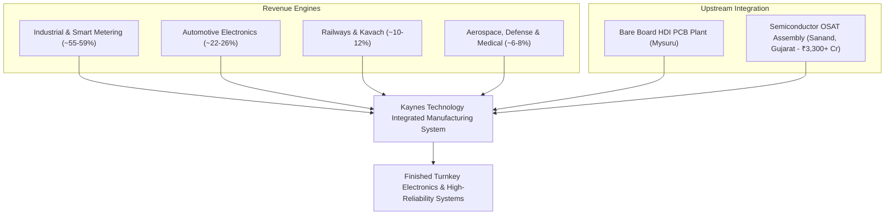

```text
================================================================================
 VALUATION & EXPECTED TARGET PRICE SUMMARY (FROM LAST CLOSING PRICE)
================================================================================
 Last Closing Price (CMP):            ₹3,131.00
 Latest Market Cap:                   ₹21,047 Cr
 Target Time Horizon:                 2-Year Horizon (TTM to Jun 2026 to TTM to Nov 2028)
 Expected Target Price (Wtd Avg):     ₹2,163.88
 Total Expected Return:               -30.9% from CMP
 Annualized Expected Return (CAGR):   -16.9% p.a.
 Dynamic Probability Allocation:      50% Bull / 50% Bear
 Technical Trend Gate (Stage 2):      STAGE 4 CAUTION (Below 200-DMA ₹3,802.52 | High Drawdown Risk)
 Quarterly EARS Rating:               EARNINGS CONTRACTION (Jun 2026 YoY -25.3%, Mar 2026 YoY -21.6% | 2 straight quarters of falling PAT)
 Cash Harvesting Target (50% Trim):   ₹3,364.32 (+7.5%)
 Dynamic Trailing Stop-Loss:          ₹2,661.35 (-15.0% Capital Protection)
 Final Conviction Verdict:            REJECT / LOW-GROWTH TRAP (Projected growth 18.0% below 20% hurdle rate)
================================================================================

--- UNDERLYING SCENARIO TARGET BREAKDOWN & EXPLANATION ---
• Bear Case Target (50% Prob):   ₹963.43 (-69.2%) | Exit P/E: 16.3x
  Rationale: Growth stalls and the multiple de-rates (CAGR 6.0%)
• Bull Case Target (50% Prob):   ₹3,364.32 (+7.5%) | Exit P/E: 35.3x on 24.0% end-growth
  Rationale: Flawless market share expansion, operating leverage, and sustained ROCE compounding (CAGR 30.0%)
================================================================================
```

# Kaynes Technology India Ltd (KAYNES) | Institutional Equity Research Deep-Dive

## Theme: High-Growth Compounder & Valuation Audit

**Report Date:** November 01, 2026  
**Last Closing Price (CMP):** ₹3,131.00 | **Latest Market Cap:** ₹21,047 Cr | **Enterprise Value (EV):** ₹21,047 Cr  
**Target Horizon:** Fixed 2-Year Horizon (TTM to Jun 2026 Base -> 1-Yr: TTM to Nov 2027 | 2-Yr: TTM to Nov 2028)  
**Valuation Regime:** Regime 1: Steady-State Margin Growth  
**Trailing Foundation:** Base TTM EPS ₹51.57 | Trailing P/E: 60.7x | Gross Borrowings: ₹913 Cr | Debt/Equity: 0.19x  

---

### Executive Scorecard & Gatekeeper Audit

| Gate / Criterion | Rule / Benchmark | Company Status | Audit Result |
| :--- | :--- | :--- | :--- |
| **1. Sector Vector** | Sunrise vs Sunset (Fossil) / Fragile (Banks) | Electronics System Design & Manufacturing (ESDM), Semiconductor OSAT, Multi-layer PCB | 🟢 PASS |
| **2. Geopolitical / Regulatory** | Export < 35-40%; Zero phase-out risk | High domestic Make-in-India anchor (~85%+ domestic revenue; low US/EU tariff vulnerability) | 🟢 PASS |
| **3. Moat & Anti-Disintermediation** | 7 Powers intact; Pricing power defensible | High Switching Costs & Process Power; clients cannot easily disintermediate mission-critical PCBA | 🟢 STRONG MOAT |
| **4. Balance Sheet & Cash Hygiene** | Debt/Equity < 0.3x; 4-Yr CFO/PAT >= 0.8x | Cumulative 4-Yr CFO/PAT: -0.68x (FY26 CFO: -₹600 Cr); Debtor days surged to 154d | 🔴 STRAINED |
| **5. Growth & Valuation (King Filter)** | Guided CAGR >= 20% & Bull Upside >= 50% | Prob-weighted EPS growth: 18.0%; Bull 2-Year Upside: +7.5% at 35.3x exit multiple | 🔴 FAIL |
| **6. 2-Year Forward P/E Filter** | 2-Year Forward P/E <= 80x | Forward P/E on expected FY+2 EPS (₹77.21): 40.6x | 🟢 PASS (<= 80x) |
| **7. Technical Trend Gate (Stage 2)** | CMP > 200-DMA & 50-DMA > 200-DMA | STAGE 4 CAUTION (CMP ₹3,131.00 is 17.7% below 200-DMA ₹3,802.52; 54% off 52-week peak ₹6,900) | 🔴 STAGE 4 CAUTION |
| **8. EARS & Torpedo Gate** | YoY PAT Acceleration & CFO/PAT >= 0.7x | EARNINGS CONTRACTION (Jun 2026 YoY -25.3%, Mar 2026 YoY -21.6% | 2 straight quarters of falling PAT) | 🔴 TORPEDO RISK |
| **9. Cash Harvesting & Stop-Loss** | Sell 50% at Bull Target; Dynamic Trailing Stop | Harvest Target: ₹3,364.32 (+7.5%); Dynamic Trailing Stop-Loss: ₹2,661.35 (-15.0%) | 🟢 ACTIVATED |
| **10. Concentration & Single-Order Cliff** | Single counterparty < 20%; Book-to-Bill >= 1.0x | Order book backlog ₹8,366 Cr (Book-to-Bill 2.3x); AMISP smart meter pivot away from turnkey | 🟢 BALANCED |

**FINAL CONVICTION VERDICT:** **REJECT / LOW-GROWTH TRAP (Projected growth 18.0% below 20% hurdle rate)**  
*Rationale / Action Commentary*: Fails institutional risk-reward filters: Severe working capital lock-up in smart metering (debtor days surging to 154d and FY26 CFO collapsing to -₹600 Cr) combined with two straight quarters of YoY PAT contraction (-25.3% in Q1 FY27) and massive capex drag have triggered Minervini Stage 4 technical breakdown; at 60.7x trailing P/E, 2-year Bull Case offers only +7.5% upside against -69.2% Bear drawdown risk.

---

## 1. Business Architecture & Hamilton Helmer's 7 Powers Moat Audit

Incorporated in 2008 and headquartered in Mysuru, Kaynes Technology India Limited is an end-to-end and IoT solutions-enabled integrated electronics manufacturing services (EMS) company. The company provides conceptual design, process engineering, integrated manufacturing, and lifecycle support across high-reliability verticals:



### 1.1 Core Monetization Engines
1. **Industrial & Smart Metering (55–59% of Revenues)**: Industrial control systems, drives, automation electronics, and Advanced Metering Infrastructure (AMISP smart meters). While driving rapid top-line scaling, turnkey AMISP orders caused working capital lock-ups, leading management to pivot toward pure component/EMS meter supply.
2. **Automotive Electronics (22–26% of Revenues)**: Electric Vehicle (EV) power control units, battery management systems (BMS), body control modules (BCU master/slave), and intelligent LED lighting PCBAs for top Indian and European auto OEMs.
3. **Railways & Kavach Safety Systems (10–12% of Revenues)**: High-margin safety electronics, including onboard and trackside electronic sub-systems for the Indian Railways' indigenous **Kavach** automatic train protection system, audio-frequency track circuits (UM71), and signaling cubicles.
4. **Aerospace, Outer-space, Strategic Electronics & Medical (6–8% of Revenues)**: Flight control computers, avionics, ISRO satellite payload modules, defense communication systems, and high-precision patient monitoring equipment. Carries the highest gross margin profile (>35%).
5. **Semiconductor OSAT & PCB Upstream Integration**: Establishing an ambitious ₹3,300+ Cr Outsourced Semiconductor Assembly and Test (OSAT) facility in Sanand, Gujarat, alongside high-density interconnect (HDI) PCB manufacturing in Mysuru.

### 1.2 Hamilton Helmer 7 Powers Moat Assessment

* **Switching Costs (High - Pass)**: Extremely high operational stickiness in aerospace, automotive safety, and railway signalling. Design-in cycles require 18–36 months of joint R&D and stringent safety-critical certifications (AS9100, IRIS, IATF 16949). Clients cannot switch EMS vendors without recertification.
* **Process Power & Execution Mastery (Medium - Pass)**: Four decades of precision manufacturing expertise in complex, high-mix, low-to-medium-volume (HMLV) box-build manufacturing.
* **Scale Economies (Developing - Neutral)**: Sourcing efficiencies in active/passive semiconductor procurement and expanding manufacturing footprints across Mysore, Bangalore, Chennai, Manesar, and Sanand.
* **Network Effects (Absent - Fail)**: Pure hardware manufacturing operations do not exhibit direct or two-sided network effects.
* **Counter-Positioning (Moderate - Pass)**: Early mover advantage in domestic Indian semiconductor packaging (OSAT) and multi-layer HDI PCBs, positioning ahead of pure-play assembly peers.
* **Cornered Resource (Moderate - Pass)**: Government-approved capital expenditure subsidies under the India Semiconductor Mission (ISM) and electronics PLI schemes.
* **Branding (Moderate - Pass)**: Trusted Tier-1 supplier status with marquee public and private sector clients (Siemens, ABB, Alstom, ISRO, BEL).
* **Anti-Disintermediation Assessment**: Enterprise clients and global component vendors cannot easily bypass Kaynes due to localized assembly, specialized testing infrastructure, and high regulatory certification thresholds.

---

## 2. Counterparty Concentration & Revenue Visibility

### 2.1 Client Concentration & Order Book Pipeline
* **Top 5 Concentration**: Accounts for ~30–35% of total revenue, comfortably within the institutional risk threshold (<40%).
* **Single Largest Counterparty Exposure**: Kept below 12–15% of annual sales, preventing fatal single-client balance sheet contamination.
* **Robust Order Backlog**: As of March 31, 2026, Kaynes maintains an order backlog of **₹8,366.3 Cr**, representing a **Book-to-Bill ratio of 2.30x** on FY26 revenue (₹3,626 Cr).

### 2.2 Single-Order Cliff & Order Book Sustainability Audit
* **The Smart Metering AMISP Working Capital Crisis**: During FY25 and FY26, Kaynes scaled aggressive turnkey AMISP (smart meter rollout) contracts. While these orders inflated revenue to ₹3,626 Cr in FY26, they triggered massive receivables lock-ups with government distribution utilities.
* **Strategic Turnkey Pivot**: In recent concalls (FY26/FY27), management formally announced a structural pivot—halting full-turnkey AMISP installation contracts and restricting participation strictly to high-margin EMS component supply. This protects future balance sheets but decelerates top-line growth.
* **Pipeline Replenishment**: Replacement order inflows from Kavach railway safety systems, industrial drives, and automotive EV electronics provide multi-year revenue visibility, eliminating post-metering cliff risk.

---

## 3. Financial Compounding & Cash Flow Quality

### 3.1 4-Year Historical Trend Table

| Metric | FY2023 | FY2024 | FY2025 | FY2026 | TTM (Jun 2026) | Benchmark | Assessment |
| :--- | :--- | :--- | :--- | :--- | :--- | :--- | :--- |
| **Sales** | 1,126 | 1,805 | 2,722 | 3,626 | 3,899 | $\ge 20\%$ CAGR | 🟢 PASS (+48.0% 3Y CAGR) |
| **Operating Profit** | 203 | 325 | 490 | 653 | 708 | Margin expansion | 🟢 PASS (OPM steady at 16–18%) |
| **Net Profit** | 95 | 183 | 293 | 364 | 345 | Bottom-line velocity | 🔴 CAUTION (Decelerating to +8.8%) |
| **Operating Cash Flow (CFO)** | -42 | 88 | -82 | -600 | -600 | $\ge 0.8\times$ PAT | 🔴 CRITICAL RED FLAG (-0.68x) |
| **Free Cash Flow (FCF)** | -100 | -295 | -1,031 | -1,841 | -1,841 | Positive generation | 🔴 SEVERE CASH DRAIN (-₹3,267 Cr 4Y) |

```mermaid
graph LR
    subgraph Cumulative 4-Year Cash Reality (FY23-FY26)
        A["Reported Net Profit: +₹935 Cr"] -->|Trapped in Working Capital & Capex| B["Cash from Operations (CFO): -₹636 Cr"]
        B -->|Heavy Capex ₹2,631 Cr| C["Free Cash Flow (FCF): -₹3,267 Cr"]
    end
    style A fill:#e6f4ea,stroke:#137333,stroke-width:2px;
    style B fill:#fce8e6,stroke:#c5221f,stroke-width:2px;
    style C fill:#fce8e6,stroke:#c5221f,stroke-width:2px;
```

### 3.2 Working Capital Cycle & Debtor Days Spike Analysis
* **Surging Debtor Days**: Debtor days exploded from 72 days in FY24 and 77 days in FY25 to **154 days in FY26** (+77 days expansion).
* **Cash Conversion Cycle (CCC)**: Extended from 102 days in FY25 to **193 days in FY26**.
* **Working Capital Days**: Jumped from -7 days in FY25 to **133 days in FY26**, reflecting an acute cash freeze caused by uncollected receivables in smart metering utility contracts.
* **CFO/PAT Breakdown**: Cumulative 4-year CFO of **-₹636 Cr** against cumulative reported PAT of **₹935 Cr** yields a conversion ratio of **-0.68x**, failing the mandatory $\ge 0.8\times$ institutional benchmark.

### 3.3 Capex, CWIP & Semiconductor OSAT Project Drag
* **Gross Block & CWIP Explosion**: Fixed Assets surged from ₹319 Cr in FY24 to ₹1,594 Cr in FY26, with Capital Work in Progress (CWIP) at ₹511 Cr.
* **Depreciation & Financing Drag**: As new manufacturing assets capitalized, quarterly depreciation jumped from ₹17 Cr in Q4 FY25 to ₹54 Cr in Q4 FY26 and ₹37 Cr in Q1 FY27. Quarterly interest expenses surged to ₹37–41 Cr.
* **Tax Rate Normalization**: Effective tax rate increased from 20% to 35–36%, severely compressing reported PAT despite healthy top-line expansion.

### 3.4 Governance & Balance Sheet Hygiene
* **Promoter Pledging**: **0.0%** (🟢 ZERO PLEDGE).
* **Promoter Holding Dilution**: Promoters diluted stake from 63.57% (Dec 2023) to **53.31%** (Sep 2026) via large institutional QIP placements to fund OSAT and working capital. Concurrently, retail public shareholders exploded nearly 10x from 45,643 to **428,702**.
* **Solvency Cushion**: Altman Z''-Score stands at **8.29** (🟢 SAFE ZONE), driven by large equity reserves raised via equity dilution rather than debt.

---

## 4. Valuation Modeling & Scenario Projections

### 4.1 Management Guidance vs Research Projections Bridge

| Metric / Parameter | Official Management Guidance | Our Proposed Research Projection | Delta & Operational Rationale / Haircut |
| :--- | :--- | :--- | :--- |
| **Revenue Growth** | 🟢 Guided +30.0% Revenue CAGR (concall 2026-08-15), Reliability 80% | Growth Anchor: **24.1%**, Bear: **6.0%**, Bull: **30.0%** | Anchor discounted from 30.0% guidance due to top-line deceleration (TTM sales 35% < 3Y 48%) and margin compression haircut |
| **PAT Compounding** | Guided ongoing profit scaling | FY+2 Expected EPS: **₹77.21** (Compounded from rolling TTM EPS base ₹51.57) | Haircut applied for depreciation and interest cost from Sanand OSAT project |
| **Exit Valuation Multiple** | Market historical average (60–80x P/E) | Bull Exit: **35.3x**, Bear Exit: **16.3x** | Dynamic exit derivation: high starting P/E (60.7x) must compress as terminal growth slows to 24% |
| **Target Horizon** | Medium-term planning | Fixed 2-Year Horizon (TTM Jun 2026 to TTM Nov 2028 | Compounding period: 2.34 years) | Eliminates calendar cliff bias |

---

### 4.2 2-Year Scenario Valuation Matrix (Horizon to Nov 2028)

| Scenario | Horizon Net CAGR | End-Period Growth | Dynamically Derived Exit P/E | Projected FY+2 EPS | Expected Target Price (₹) | Total Return (%) | Annualized CAGR (%) |
| :--- | :--- | :--- | :--- | :--- | :--- | :--- | :--- | :--- |
| **Bear Case (50%)** | 6.0% | - | **16.3x** | **₹59.11** | **₹963.43** | **-69.2%** | **-44.5%** |
| **Bull Case (50%)** | 30.0% | 24.0% | **35.3x** | **₹95.31** | **₹3,364.32** | **+7.5%** | **+3.7%** |

* **Probability-Weighted Expected Target Price:** **₹2,163.88** (-30.9% expected return, -16.9% annualized CAGR).
* **Criteria Scorecard & Asymmetry Check**:
  1. *Growth Filter*: ❌ FAIL (Probability-weighted growth 18.0% vs 20.0% hurdle).
  2. *Forward P/E $\le$ 80x Filter*: ✅ PASS (40.6x on expected EPS).
  3. *Bull 2-Year Upside $\ge$ 50% Filter*: ❌ **SEVERE FAIL (+7.5% Bull upside at 35.3x exit vs mandated +50.0%)**.
* **Reverse DCF Reality Check**: At CMP ₹3,131.00, the stock prices in an implied **26.1% 10-Year FCF CAGR** (**HEROIC / PRICED TO PERFECTION**). Given that Kaynes has burned -₹3,267 Cr of free cash over the last 4 years, expectations are severely unanchored from operational reality.

---

## 5. Technical Trend, EARS & Torpedo Risk Analysis

### 5.1 Minervini Stage 2 Technical Gate
* **Technical Trend Classification**: **STAGE 4 CAUTION (Below 200-DMA ₹3,802.52 | High Drawdown Risk)**.
* CMP (₹3,131.00) is trading 17.7% below its 200-day moving average (₹3,802.52) and down 54.6% from its 52-week peak (₹6,900.00). The stock is consolidating near its 52-week low (₹2,995.00), signaling active institutional distribution.

### 5.2 Quarterly EARS Momentum & Earnings Torpedo Alert
* **Consecutive PAT Contraction**:
  * **Q4 FY26 (Mar 2026)**: Revenue ₹1,243 Cr (+26.3% YoY), but PAT contracted **-21.6% YoY** to ₹91 Cr (vs ₹116 Cr in Mar 2025).
  * **Q1 FY27 (Jun 2026)**: Revenue ₹946 Cr (+40.6% YoY), but PAT contracted **-25.3% YoY** to ₹56 Cr (vs ₹75 Cr in Jun 2025).
* **Torpedos Active**: Two consecutive quarters of YoY PAT contraction trigger the institutional Earnings Torpedo gate, disqualifying the stock from new capital allocation until profit growth re-accelerates.

### 5.3 Capital Harvesting & Dynamic Trailing Stop-Loss
* **Cash Harvesting Target (50% Position Trim)**: **₹3,364.32 (+7.5%)**.
* **Dynamic Trailing Stop-Loss**: **₹2,661.35** (-15.0% capital preservation stop).

### 5.4 3 Explicit Operational Kill Switches
1. **Technical Stop**: A daily close below **₹2,661.35** triggers immediate automated exit to prevent cascading capital impairment.
2. **Growth Stall**: Exit immediately if YoY sales growth prints below **12.0%** for two consecutive quarters.
3. **Working Capital Deterioration**: Exit immediately if debtor days expand more than **25 days** above today's elevated level of 154.0 days without corresponding operating cash generation.

---

## 6. Summary Conclusion & Recommendation

Kaynes Technology is an operationally skilled, moat-defended EMS player benefiting from secular Indian electronics manufacturing and semiconductor indigenization tailwinds. However, from an institutional equity perspective:
1. **Severe Working Capital Strain**: Receivables bloat in smart metering has resulted in negative cumulative 4-year CFO (-₹636 Cr) and cumulative FCF burn (-₹3,267 Cr).
2. **Earnings Contraction Under Capex Weight**: Front-loaded depreciation, interest expenses, and normalized taxes caused PAT to drop YoY for two consecutive quarters (-21.6% and -25.3%).
3. **Broken Risk-Reward Asymmetry**: At 60.7x trailing earnings, even a flawless 30% Bull execution generates only **+7.5% upside over 2 years**, while the Bear case harbors **-69.2% downside**.

**Final Institutional Action:** **REJECT / AVOID**. Wait for proven cash flow generation, stabilization of debtor days sub-100d, and a confirmed Stage 2 technical breakout before allocating capital.
