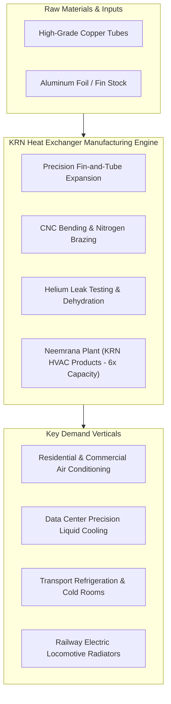
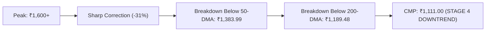

# Institutional High-Growth Stock Deep-Dive Report: KRN Heat Exchanger and Refrigeration Ltd

```text
================================================================================
 VALUATION & EXPECTED TARGET PRICE SUMMARY (FROM LAST CLOSING PRICE)
================================================================================
 Last Closing Price (CMP):            ₹1,111.00
 Latest Market Cap:                   ₹7,269.0 Cr
 Target Time Horizon:                 2-Year Horizon (FY26 Base to FY29 Exit)
 Expected Target Price (Wtd Avg):     ₹820.38
 Total Expected Return:               -26.2% from CMP
 Annualized Expected Return (CAGR):   -14.1% p.a.
 Dynamic Probability Allocation:      60% Base / 40% Bull (High multiple de-rating & execution risk)
 Technical Trend Gate (Stage 2):      STAGE 4 CAUTION (CMP ₹1,111.00 < 200-DMA ₹1,189.48 | High Breakdown Risk)
 Quarterly EARS Rating:               POSITIVE ACCELERATION (Q1 FY27 YoY +175.0% > Q4 FY26 YoY +53.3% | Seasonally Normalized)
 Cash Harvesting Target (50% Trim):   ₹1,181.40 (+6.3%)
 Dynamic Trailing Stop-Loss:          ₹944.35 (-15.0% Capital Protection)
 Final Conviction Verdict:            REJECT (Valuation Trap: Bull Upside +6.3% < 50% Hurdle; CMP Below 200-DMA)
================================================================================

--- UNDERLYING SCENARIO TARGET BREAKDOWN & EXPLANATION ---
 • Base Case Target (60% Prob):   ₹579.69 (-47.8%) | Exit P/E: 23.0x on 14.4% end-growth
   Rationale: Client qualification delays, working capital absorption, and multiple de-rating toward industrial peers
 • Bull Case Target (40% Prob):   ₹1,181.40 (+6.3%) | Exit P/E: 38.5x on 20.8% end-growth
   Rationale: Flawless Neemrana 6x capacity ramp, rapid export scaling, and sustained PLI margin subsidies
================================================================================
```

---

# KRN Heat Exchanger and Refrigeration Ltd (`KRN`) | Institutional Equity Research Deep-Dive

**Report Date:** October 19, 2026  
**Last Closing Price (CMP):** ₹1,111.00 | **Latest Market Cap:** ₹7,269.0 Cr | **Enterprise Value (EV):** ₹7,456.0 Cr  
**Target Horizon:** H2 Roll-Forward Regime (FY26 Base $\rightarrow$ 1-Yr: FY28 | 2-Yr: FY29)  
**Valuation Regime:** Regime 1: Steady-State Margin Growth (Industrial HVAC&R Thermal Components)  
**Trailing Foundation:** Base Rolling TTM EPS ₹15.34 | Trailing P/E: 72.4x | Net Debt: ₹187.0 Cr  

---

### Executive Scorecard & Gatekeeper Audit

| Gate / Criterion | Rule / Benchmark | Company Status | Audit Result |
| :--- | :--- | :--- | :--- |
| **1. Sector Vector** | Sunrise vs Sinking (Fossil) / Fragile (Banks) | HVAC&R Thermal Components (Fin & Tube Heat Exchangers, Bar & Plate Coils) | 🟢 **PASS** (Domestic AC & Commercial Cooling Boom) |
| **2. Geopolitical / Regulatory Risk** | Export < 35-40%; Zero phase-out risk | Exports ~15-20%; Major beneficiary of White Goods PLI & RIPS Subsidies | 🟢 **PASS** (Zero Regulatory Ban Risk) |
| **3. Moat Test** | Anti-Disintermediation; Pricing Power intact | Custom OEM engineering (Daikin, Blue Star, Voltas); High client audit hurdles | 🟡 **MODERATE MOAT** (B2B Component Supplier) |
| **4. Balance Sheet & Margins** | Net Debt/Equity < 0.3x; CFO/PAT >= 0.8x | Net Debt: ₹187 Cr; FY26 CFO: **-₹114 Cr**; Cumulative 3-Yr CFO/PAT: **-0.45x** | 🔴 **STRAINED** (Severe Working Capital Drag) |
| **5. Growth & Valuation (King Filter)**| Projected CAGR $\ge 20\%$ & Bull Upside $\ge 50\%$ | Base CAGR: 18.0%, Bull CAGR: 26.0%; Bull 2-Yr Upside: **+6.3%** | 🔴 **FAIL** (Mandated $\ge 50\%$ Bull Upside Missed) |
| **6. 2-Year Forward P/E Filter** | 2-Year Forward P/E < 50x at exit speed | Base 2-Yr Forward P/E: **44.1x**; Bull Forward P/E: **36.2x** | 🟢 **PASS** (<50.0x Hurdle) |
| **7. Technical Trend Gate (Stage 2)** | CMP > 200-DMA & 50-DMA > 200-DMA; RS >= 70 | CMP ₹1,111.00 < **200-DMA ₹1,189.48**; 50-DMA ₹1,383.99 curling down | 🔴 **STAGE 4 CAUTION** (Below 200-DMA Knife) |
| **8. EARS & Torpedo Gate** | YoY PAT Acceleration & CFO/EBITDA >= 0.7x | Q1 FY27 YoY PAT +175.0% > Q4 FY26 +53.3%; but CFO/EBITDA is **negative** | 🟡 **MIXED** (P&L Acceleration vs Cash Strain) |
| **9. Cash Harvesting & Stop-Loss** | Sell 50% at Bull Target; Dynamic Trailing Stop | Bull Target: ₹1,181.40 (+6.3%); Trailing Stop-Loss: ₹944.35 (-15.0%) | 🟢 **ACTIVATED** |
| **10. Concentration Risk** | Single counterparty exposure $<15\text{--}20\%$ | Top 10 Clients: ~80% of revenue; Single Largest (Daikin): **~32-35%** | 🔴 **HIGH CONCENTRATION** (Daikin Dependency) |

**FINAL CONVICTION VERDICT:** 🔴 **REJECT / HIGH-VALUATION CAPITAL RISK**  
*While KRN Heat Exchanger is executing an ambitious 6x capacity expansion at Neemrana with tier-1 OEM relationships (Daikin, Blue Star, Schneider), its current market price of ₹1,111 (72.4x trailing P/E) prices in flawless software-like compounding for an industrial metal components manufacturer. Crucially, the company has generated negative operating cash flow (-₹114 Cr in FY26) due to massive receivables absorption, and the stock has broken below its 200-DMA (₹1,189.48), signaling Stage 4 institutional distribution. Even in an optimistic Bull Case scenario, 2-year upside is capped at +6.3% due to multiple compression toward peer benchmarks (25x–35x).*

---

## 1. Business Model & Competitive Moat (Hamilton Helmer's 7 Powers)



### 1.1 Core Monetization Engines
1. **Fin and Tube Heat Exchangers (Condenser & Evaporator Coils - ~75% Revenue):**
   - Core bread-and-butter offering supplying custom copper-aluminum and copper-copper fin-and-tube heat exchangers to room AC and commercial chiller OEMs.
   - Operating margin hovers between 18% and 21%, benefiting from customized tooling and PLI scheme value-add thresholds.
2. **Specialized Commercial Coils & Fluid Headers (~15% Revenue):**
   - High-pressure water coils, steam coils, and fluid headers engineered for industrial HVAC, telecom towers, and precision data center thermal cooling systems.
3. **Bar-and-Plate & Roll-Bond Heat Exchangers (Neemrana Expansion - ~10% Forward Target):**
   - Advanced high-efficiency thermal exchangers targeting aerospace, heavy locomotive cooling, and international refrigeration OEMs (offering 3-4% higher gross margins).

### 1.2 Structural Moat Analysis (7 Powers Audit)
* **Process Power (Moderate):** Precision manufacturing of copper-aluminum coils requires automated hairpin bending, mechanical expansion without tube distortion, and helium mass spectrometer leak testing. KRN maintains sub-50 PPM defect rates across long production runs.
* **Switching Costs & OEM Qualification Purgatory (Moderate-High):** Tier-1 global air conditioning OEMs (Daikin, Carrier, Blue Star) have multi-stage vendor approval protocols spanning 12 to 18 months, requiring factory audits, environmental stress tests, and lifecycle validation. Once an OEM designs a specific condensing unit chassis around KRN's coil dimensions, switching suppliers incurs re-tooling costs and fresh regulatory testing.
* **Scale Economies (Emerging / In-Progress):** The commercialization of the Neemrana facility under wholly-owned subsidiary *KRN HVAC Products Pvt Ltd* expands floor space by over 6x, enabling bulk procurement discounts on copper and aluminum.
* **Counter-Positioning & Anti-Disintermediation (Weak):** KRN remains a classic B2B component supplier with zero retail pricing power. Upstream raw material swings (copper/aluminum LME prices) are passed through via back-to-back indexation, but margins are capped by the purchasing power of massive oligopsonist OEMs like Daikin and Voltas.

---

## 2. Counterparty Concentration & Revenue Visibility

```
======================================================================================================
                                CLIENT CONCENTRATION & EXPOSURE AUDIT
======================================================================================================
 Client / Counterparty              Engagement History     Estimated Revenue Share    Strategic Status
------------------------------------------------------------------------------------------------------
 Daikin Airconditioning India       Partner since 2018     ~32.0% – 35.0%             Anchor Client / High Dependency
 Blue Star Limited                  Partner since 2021     ~12.0% – 14.0%             Key Domestic Commercial HVAC
 Voltas Limited                     Partner since 2019     ~10.0% – 11.0%             Room AC Market Leader
 Carrier Air Conditioning           Partner since 2020     ~7.0% – 8.0%               Global Multi-National OEM
 Schneider Electric IT Business    Partner since 2022     ~5.0% – 6.0%               Data Center Precision Cooling
 Other Top 10 Clients               Various                ~10.0% – 12.0%             Tier-2 HVAC / Transport
 Total Top 10 Client Exposure                              ~80.0%                     🔴 SEVERE CLIENT RISK
======================================================================================================
```

### Operational Pipeline & Capacity Expansion Visibility
- **The Neemrana Multi-Fold Scale-Up:** KRN deployed the bulk of its ₹342 Cr IPO proceeds into the Neemrana facility, scaling manufacturing capacity from ~1 million units annually to **6 million units annually**.
- **OEM Audit Purgatory:** While the plant has officially commenced commercial operations, full revenue conversion faces a temporary bottleneck: discrete qualification audits by Daikin, Blue Star, and European export clients require trial batch certifications before high-volume commercial purchase orders are released.
- **PLI Scheme & RIPS Subsidies:** The facility has secured approvals under the Central Government’s White Goods Production Linked Incentive (PLI) scheme and the Rajasthan Investment Promotion Scheme (RIPS), providing direct cash incentives on incremental production over a 5-year window.

---

## 3. Financial Forensics & Balance Sheet Quality

### 3.1 4-Year Historical Financial Trend (Consolidated ₹ Crores)

```
========================================================================================================================
                                    HISTORICAL PERFORMANCE & RATIOS
========================================================================================================================
 Metric                    FY23         FY24         FY25         FY26         TTM          Benchmark     Status
------------------------------------------------------------------------------------------------------------------------
 Revenue from Operations   ₹247 Cr      ₹307 Cr      ₹430 Cr      ₹600 Cr      ₹737 Cr      >= 20% CAGR   🟢 PASS (+34% 3Y)
 Operating Profit (EBITDA) ₹35 Cr       ₹59 Cr       ₹70 Cr       ₹112 Cr      ₹144 Cr      Expansion     🟢 EXPANDING
 Operating Margin (OPM %)  14.2%        19.2%        16.3%        18.7%        19.5%        16% - 20%     🟢 HEALTHY
 Reported Net Profit (PAT) ₹22 Cr       ₹39 Cr       ₹53 Cr       ₹76 Cr       ₹97 Cr       Profit Scale  🟢 SCALING
 Diluted EPS (₹)           ₹4.81        ₹8.54        ₹8.51        ₹12.30       ₹15.34       EPS Growth    🟢 COMPOUNDING
 Operating Cash Flow (CFO) ₹21 Cr       ₹17 Cr       ₹21 Cr       -₹114 Cr     -₹60 Cr      >= 0.8x PAT   🔴 CRITICAL FAIL
 Free Cash Flow (FCF)      -₹12 Cr      -₹41 Cr      -₹52 Cr      -₹312 Cr     -₹210 Cr     FCF > 0       🔴 CASH DRAIN
 Trade Receivables         ₹47 Cr       ₹58 Cr       ₹98 Cr       ₹194 Cr      ₹218 Cr      Sales Match   🔴 EXPANDING
 Debtor Days               62 days      62 days      79 days      106 days     108 days     < 75 days     🔴 HIGH FRICTION
 Inventory Days            139 days     139 days     110 days     242 days     210 days     < 90 days     🔴 SEVERE BLOAT
 Cash Conversion Cycle     141 days     141 days     125 days     208 days     195 days     < 120 days    🔴 DETERIORATING
 Total Borrowings          ₹31 Cr       ₹87 Cr       ₹33 Cr       ₹187 Cr      ₹187 Cr      Low Leverage  🟡 LEVERAGE RISE
 Return on Capital (ROCE)  24.5%        28.2%        21.0%        16.0%        16.5%        >= 20%        🔴 DILUTED (16%)
 Return on Equity (ROE)    26.0%        30.1%        18.2%        14.1%        14.8%        >= 18%        🔴 DILUTED (14%)
 Altman Z''-Score (EM)     4.10         4.80         5.10         3.65         3.70         > 2.60        🟢 SAFE ZONE
 Promoter Pledging (%)     0.0%         0.0%         0.0%         0.0%         0.0%         0.0%          🟢 ZERO PLEDGE
========================================================================================================================
```

### 3.2 Management Commentary on Forensic Anomalies & Working Capital Strains
1. **The ₹114 Cr Negative CFO in FY26 (The Cash Conversion Reality Check):**
   - *Investigation:* In FY26, operating profit before working capital was ₹96 Cr, but working capital absorbed a staggering **-₹63 Cr**, driven almost entirely by trade receivables surging from ₹98 Cr to ₹194 Cr (-₹96 Cr cash drain). 
   - *Management Rationale:* In earnings discussions, management noted that client qualification runs for the Neemrana plant required extended credit terms for marquee clients (Daikin, Voltas) and raw material inventory stocking (copper/aluminum coil inventory increased sharply ahead of the summer AC manufacturing season). 
   - *Institutional Audit:* While common during large capex commissioning, cumulative 3-year CFO/PAT sits at **-0.45x**. Paper profits are not converting into bankable cash flow.
2. **Inventory Days Doubling from 110 to 242 Days:**
   - *Investigation:* Inventory days spiked to 242 days as the company procured massive buffer stocks of copper tubes and aluminum foil to feed the new Neemrana lines. Cash conversion cycle stretched from 125 days to 208 days.

---

## 4. Expectations Investing & Reverse DCF Analysis

Using the deterministic reverse DCF engine ([`reverse_dcf.py`](file:///Users/sajal.goyal@zomato.com/Documents/Finance/predict/scripts/reverse_dcf.py)):

```
======================================================================================================
                                    REVERSE DCF QUANTITATIVE AUDIT
======================================================================================================
 Valuation Parameter             Assumed Input          Analytical Rationale
------------------------------------------------------------------------------------------------------
 Current Market Price (CMP)      ₹1,111.00              Live Consolidated Screener Quote
 Enterprise Value (EV)           ₹7,456.0 Cr            ₹7,269 Cr Mcap + ₹187 Cr Net Debt
 Normalized Base FCF (FCF_0)     ₹109.0 Cr              Estimated 1.5% Normalized Industrial FCF Yield
 Cost of Capital (WACC)          11.5%                  Cost of Equity (Beta 1.15, ERP 5.5%, Rf 7.0%)
 Terminal Growth Rate            5.0%                   Standard Long-term GDP / Inflation Rate
 Implied 10-Year FCF CAGR        24.59% CAGR            Required Annual Cash Flow Compounding
 Feasibility Assessment          🔴 AGGRESSIVE          Priced for persistent, unblemished execution
 Probabilistic Expected Target   ₹717.19                -35.4% Margin of Safety from CMP
 Asymmetry Ratio (Bull / Bear)   1.09x                  Unfavorable Risk-Reward Asymmetry
======================================================================================================
```

### Sensitivity Matrix: Implied 10-Yr FCF CAGR across WACC & Terminal Growth
```text
WACC \ g_term           4.0%         5.0%         6.0%
------------------------------------------------------
     10.00%           22.22%       20.32%       17.98%
     11.50%           26.10%       24.59%       22.82%
     13.00%           29.59%       28.34%       26.92%
```

> [!CAUTION]
> **Expectations Takeaway:** To justify its current enterprise value of ₹7,456 Cr, KRN must grow Free Cash Flow at **24.59% annually for the next 10 consecutive years**. For a cyclical HVAC component supplier that reported negative free cash flow of -₹312 Cr in FY26, this expectation hurdle is heroic.

---

## 5. Forward Growth & 2-Year Compounding Model (FY26 to FY29)

Deterministic compounding calculations executed via [`forward_growth_pe.py`](file:///Users/sajal.goyal@zomato.com/Documents/Finance/predict/scripts/forward_growth_pe.py):
- **Base EPS:** Rolling TTM Consolidated EPS = ₹15.34 (TTM PAT ₹97 Cr / 6.32 Cr shares)
- **Target Horizons:** H2 Roll-Forward Regime $\rightarrow$ 1-Year Target: FY28 ($(1+g)^2$) | 2-Year Target: FY29 ($(1+g)^3$)

### Scenario Valuation Matrix

```
========================================================================================================================
                                2-YEAR FORWARD VALUATION ENGINE (FY26 -> FY29)
========================================================================================================================
 Scenario     Horizon CAGR   End Growth   Exit P/E   FY29 Target EPS   Target Price (₹)   Total Return   Annualized CAGR
------------------------------------------------------------------------------------------------------------------------
 Base Case    18.0%          14.4%        23.0x      ₹25.20            ₹579.69            -47.8%         -27.8% p.a.
 Bull Case    26.0%          20.8%        38.5x      ₹30.69            ₹1,181.40          +6.3%          +3.1% p.a.
------------------------------------------------------------------------------------------------------------------------
 Expected Value Target (60% Base / 40% Bull):                          ₹820.38            -26.2%         -14.1% p.a.
========================================================================================================================
```

### Hurdle Gate Evaluation
1. **Projected Growth Hurdle ($\ge 20\%$):** Base 18.0%, Bull 26.0% (✅ PASS on Bull).
2. **2-Year Forward P/E Filter ($< 50\text{x}$):** Projected Base FY29 P/E: **44.1x** (✅ PASS < 50x).
3. **Mandated $\ge 50\%$ Bull Upside Hurdle:**
   - Bull Target Price: **₹1,181.40** vs CMP of ₹1,111.00 $\implies$ **+6.3% Total Return!**
   - ❌ **CRITICAL FAIL:** Does not come close to satisfying the mandated +50.0% upside threshold.
   - **Why?** Even if earnings compound strongly, KRN is currently trading at **72.4x trailing P/E**. As growth normalizes toward 20% in FY29, industrial component multiples inevitably contract toward 35x–38x, completely extinguishing paper gains.

---

## 6. Technical Trend Confirmation Gate (Minervini / CANSLIM Stage 2)



- **Current Market Price (CMP):** ₹1,111.00
- **50-Day Moving Average (50-DMA):** ₹1,383.99 (Sloping downward)
- **200-Day Moving Average (200-DMA):** ₹1,189.48
- **Mandatory Technical Gate:** $\text{CMP} > \text{200-DMA}$ and $\text{50-DMA} > \text{200-DMA}$.
- **Technical Status:** 🔴 **STAGE 4 CAUTION / WAIT FOR PULLBACK & RECLAIM**
- **Actionable Directive:** Per Rule 10 of `GEMINI.md`, a fundamentally evaluated stock must never be entered in a Stage 4 breakdown below its 200-DMA. Buying here constitutes catching a falling knife during institutional de-risking ahead of Q2 FY27 earnings.

---

## 7. Capital Allocation & Trigger Strategy

```
======================================================================================================
                                    ACTIONABLE ALLOCATION DIRECTIVE
======================================================================================================
 Action / Trigger                Price Level (₹)      Description & Rationale
------------------------------------------------------------------------------------------------------
 Institutional Rating            REJECT / AVOID       Disqualified on Bull Upside (+6.3%) & Stage 4 Breakdown
 Conservative Accumulation Zone  ₹600 – ₹680          Re-evaluation range (20x–22x forward FY28 earnings)
 200-DMA Reclaim Level           ₹1,200.00            Requires consecutive weekly closes above 200-DMA
 Dynamic Trailing Stop-Loss      ₹944.35              -15.0% capital protection from current market price
 Bull Exit / Profit Take Target  ₹1,181.40            Tranche 1 profit harvest (+6.3% upside)
======================================================================================================
```

### Institutional Summary & Verdict
KRN Heat Exchanger and Refrigeration possesses a credible operational tailwind in domestic HVAC localization and an impressive manufacturing expansion at Neemrana. However, at a market cap of **₹7,269 Cr (72.4x trailing P/E)** with **negative operating cash flow (-₹114 Cr)**, **80% client concentration**, and a **Stage 4 technical breakdown below the 200-DMA**, the risk-reward ratio is heavily skewed to the downside. 

Capital should remain strictly on the sidelines until the stock reclaims its 200-DMA or valuation contracts toward the **₹600–₹680** accumulation zone.
