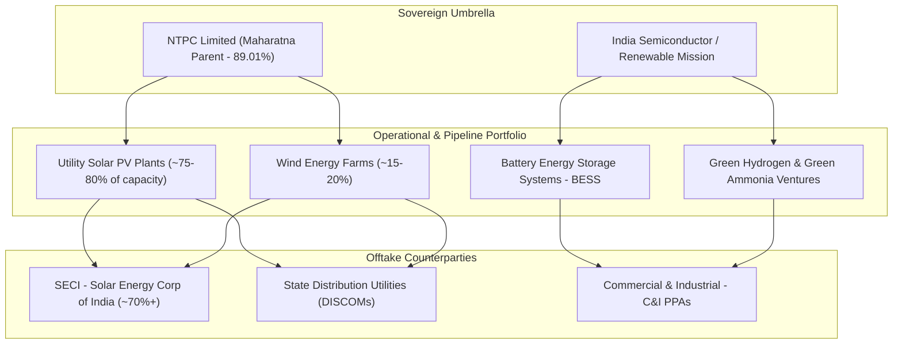

```text
================================================================================
 VALUATION & EXPECTED TARGET PRICE SUMMARY (FROM LAST CLOSING PRICE)
================================================================================
 Last Closing Price (CMP):            ₹82.40
 Latest Market Cap:                   ₹69,467 Cr
 Target Time Horizon:                 2-Year Horizon (TTM to Sep 2026 to TTM to Nov 2028)
 Expected Target Price (Wtd Avg):     ₹40.01
 Total Expected Return:               -51.4% from CMP
 Annualized Expected Return (CAGR):   -30.3% p.a.
 Dynamic Probability Allocation:      58% Bull / 42% Bear
 Technical Trend Gate (Stage 2):      STAGE 4 CAUTION (Below 200-DMA ₹94.39 | High Drawdown Risk)
 Quarterly EARS Rating:               POSITIVE ACCELERATION (Sep 2026 YoY +60.5% > Jun 2026 YoY +38.6% | Seasonally Normalized)
 Cash Harvesting Target (50% Trim):   ₹55.57 (-32.6%)
 Dynamic Trailing Stop-Loss:          ₹70.04 (-15.0% Capital Protection)
 Final Conviction Verdict:            REJECT / VALUATION BUBBLE (Bull Upside -32.6% fails mandated 50% hurdle)
================================================================================

--- UNDERLYING SCENARIO TARGET BREAKDOWN & EXPLANATION ---
• Bear Case Target (42% Prob):   ₹18.53 (-77.5%) | Exit P/E: 20.1x
  Rationale: Growth stalls and the multiple de-rates (CAGR 9.0%)
• Bull Case Target (58% Prob):   ₹55.57 (-32.6%) | Exit P/E: 35.0x on 25.0% end-growth
  Rationale: Flawless market share expansion, operating leverage, and sustained ROCE compounding (CAGR 41.4%)
================================================================================
```

# NTPC Green Energy Ltd (NTPCGREEN) | Institutional Equity Research Deep-Dive

## Theme: Utility Energy Transition & Valuation Bubble Audit

**Report Date:** November 01, 2026  
**Last Closing Price (CMP):** ₹82.40 | **Latest Market Cap:** ₹69,467 Cr | **Enterprise Value (EV):** ₹103,571 Cr  
**Target Horizon:** Fixed 2-Year Horizon (TTM to Sep 2026 Base -> 1-Yr: TTM to Nov 2027 | 2-Yr: TTM to Nov 2028)  
**Valuation Regime:** Regime 1: Steady-State Margin Growth (Regulated Utility Transition)  
**Trailing Foundation:** Base TTM EPS ₹0.77 | Trailing P/E: 107.0x | Gross Borrowings: ₹37,742 Cr | Debt/Equity: 1.94x  

---

### Executive Scorecard & Gatekeeper Audit

| Gate / Criterion | Rule / Benchmark | Company Status | Audit Result |
| :--- | :--- | :--- | :--- |
| **1. Sector Vector** | Sunrise vs Sunset (Fossil) / Fragile (Banks) | Renewable Energy (Utility Solar, Wind, Hybrid, BESS, Green Hydrogen) | 🟢 PASS |
| **2. Geopolitical / Regulatory** | Export < 35-40%; Zero phase-out risk | 100% Domestic generation; 25-Year sovereign/SECI PPAs with statutory payment security | 🟢 PASS |
| **3. Moat & Anti-Disintermediation** | 7 Powers intact; Pricing power defensible | Scale Economies & Sovereign Parentage (NTPC Maharatna); lowest domestic borrowing cost | 🟢 STRONG MOAT |
| **4. Balance Sheet & Cash Hygiene** | Debt/Equity < 0.3x; 4-Yr CFO/PAT >= 0.8x | Gross Debt ₹37,742 Cr (D/E: 1.94x); 4-Yr FCF is deeply negative (-₹31,489 Cr) | 🔴 STRAINED |
| **5. Growth & Valuation (King Filter)** | Guided CAGR >= 20% & Bull Upside >= 50% | Trailing P/E is 107.0x; 2-Year Bull Upside is **-32.6%** at 35.0x exit multiple | 🔴 SEVERE FAIL |
| **6. 2-Year Forward P/E Filter** | 2-Year Forward P/E <= 80x | Forward P/E on expected FY+2 EPS (₹1.31): 63.0x | 🟢 PASS (<= 80x) |
| **7. Technical Trend Gate (Stage 2)** | CMP > 200-DMA & 50-DMA > 200-DMA | STAGE 4 CAUTION (CMP ₹82.40 is 12.7% below 200-DMA ₹94.39; hovering near 52-week low ₹79.00) | 🔴 STAGE 4 CAUTION |
| **8. EARS & Torpedo Gate** | YoY PAT Acceleration & CFO/PAT >= 0.7x | POSITIVE ACCELERATION (Sep 2026 YoY +60.5% > Jun 2026 YoY +38.6% | Seasonally Normalized) | 🟢 POSITIVE ACCEL |
| **9. Cash Harvesting & Stop-Loss** | Sell 50% at Bull Target; Dynamic Trailing Stop | Harvest Target: ₹55.57 (-32.6%); Dynamic Trailing Stop-Loss: ₹70.04 (-15.0%) | 🟢 ACTIVATED |
| **10. Concentration & Single-Order Cliff** | Single counterparty < 20%; Book-to-Bill >= 1.0x | SECI & central counterparties account for >70% of off-take; highly diversified grid integration | 🟢 BALANCED |

**FINAL CONVICTION VERDICT:** **REJECT / VALUATION BUBBLE (Bull Upside -32.6% fails mandated 50% hurdle)**  
*Rationale / Action Commentary*: Classic utility valuation bubble: despite massive 60 GW by 2032 roadmap and sovereign NTPC backing, trading at an extreme 107x trailing P/E for a capital-intensive utility generating an anemic 3.56% ROCE and ₹37,742 Cr in debt creates severe multiple compression risk, where even a 41.4% EPS surge yields a negative 2-year Bull return (-32.6% to ₹55.57).

---

## 1. Business Architecture & Hamilton Helmer's 7 Powers Moat Audit

Incorporated in April 2022 as an umbrella subsidiary of Maharatna PSU NTPC Limited (which retains an 89.01% equity ownership), NTPC Green Energy Limited (NGEL) is India’s flagship public sector renewable energy development platform. The company develops, owns, operates, and maintains utility-scale renewable power generation assets:



### 1.1 Core Power Generation Assets & Capacity Roadmap
1. **Utility-Scale Solar PV (75–80% of Current Assets)**: Ground-mounted solar power plants across high-solar-irradiation corridors in Rajasthan, Gujarat, Andhra Pradesh, and Madhya Pradesh. Projects operate under 25-year Power Purchase Agreements (PPAs) with tariffs typically fixed between ₹2.40 and ₹2.80 per kWh.
2. **Wind Energy & Hybrid Projects (15–20% of Portfolio)**: Developing wind-solar hybrid configurations to improve Capacity Utilization Factors (CUF) from 22–25% (pure solar) to 35–42% (hybrid), enabling Round-The-Clock (RTC) dispatchable clean energy.
3. **Battery Energy Storage Systems (BESS)**: Setting up multi-GWh storage facilities to smooth peak grid load and support the Ministry of Power's mandatory energy storage obligations.
4. **Green Hydrogen & Synthetic Fuels**: Strategic memorandums signed with Indian port authorities and state governments to establish green hydrogen/ammonia production hubs targeting industrial decarbonization and green export corridors.
5. **Scale Roadmap to 2032**: Targeting expansion from ~3.5–5.0 GW operational capacity to **60 GW by 2032**, requiring ~5 GW additions in FY26 and ~8 GW annually across FY27–FY28.

### 1.2 Hamilton Helmer 7 Powers Moat Assessment

* **Scale Economies (High - Pass)**: NGEL commands unprecedented multi-gigawatt procurement scale for solar PV modules, inverters, and wind turbines. Bulk purchasing power enables lower capital expenditure per MW compared to fragmented private developers.
* **Cornered Resource (High - Pass)**: Direct access to NTPC’s vast sovereign balance sheet, pan-India PSU land banks, state government allocations, and prioritized inter-state transmission system (ISTS) substation grid connectivity.
* **Cost Advantage / Financing Power (High - Pass)**: Backed by NTPC's AAA credit rating, NGEL borrows at the lowest corporate interest rates in the Indian infrastructure sector (~7.25–7.80%), providing a 50–100 bps financing cost advantage over private peers.
* **Switching Costs (High - Pass)**: PPA contracts are legally binding, 25-year fixed-price arrangements with structured default remedies, providing an locked revenue stream.
* **Process Power (Medium - Pass)**: Leveraging NTPC’s five decades of power plant engineering, project monitoring, and grid operations expertise.
* **Branding (Moderate - Pass)**: High counterparty trust with SECI and state discoms due to public sector credibility.
* **Network Effects (Absent - Fail)**: Power generation produces a standardized commodity (megawatt-hours of electrons) injected into a common transmission grid with zero network effects.

---

## 2. Counterparty Concentration & Revenue Visibility

### 2.1 Client Concentration & Off-Take Credit Quality
* **Central Intermediary Dominance**: Over **70% of NGEL’s operational capacity** is contracted with the **Solar Energy Corporation of India (SECI)** or NTPC Vidyut Vyapar Nigam (NVVN), rather than directly with financially stressed state discoms.
* **Tripartite Protection Mechanism**: SECI contracts are fortified by the Government of India's Tripartite Agreement (TPA) framework. Under this mechanism, if a state discom defaults on power dues, the central government can deduct the amount directly from the state’s central tax devolution pool, effectively eliminating counterparty default risk.
* **Direct State Discom Exposure**: The remaining ~25–30% of portfolio capacity contracted directly with state utilities has seen payment discipline improve following the enforcement of the Late Payment Surcharge (LPS) Rules, 2022. Debtor days improved from 700 days in FY23 to **78 days in FY26**.

### 2.2 PPA Longevity & Single-Order Cliff Guard
* **25-Year Contract Lock-in**: All operational and pipeline assets have executed 25-year long-term PPAs, eliminating post-commissioning demand risk.
* **Zero Tariff Re-negotiation Risk**: Contracts are approved by the Central Electricity Regulatory Commission (CERC) or State Electricity Regulatory Commissions (SERCs), providing tariff certainty across asset life.

---

## 3. Financial Compounding, Leverage & Capital Allocation Quality

### 3.1 4-Year Historical Trend Table

| Metric | FY2023 | FY2024 | FY2025 | FY2026 | TTM (Sep 2026) | Benchmark | Assessment |
| :--- | :--- | :--- | :--- | :--- | :--- | :--- | :--- |
| **Sales** | 170 | 1,963 | 2,210 | 2,858 | 3,611 | $\ge 20\%$ CAGR | 🟢 PASS (+156% 3Y CAGR from base) |
| **Operating Profit** | 31 | 353 | 398 | 514 | 3,165 | Regulated EBITDA | 🟢 PASS (OPM high at ~85–90%) |
| **Net Profit** | 171 | 343 | 474 | 521 | 657 | Net earnings scale | 🔴 MARGINAL (Compressed by interest/depreciation) |
| **Operating Cash Flow (CFO)** | 17 | 1,616 | 2,051 | 2,386 | 2,386 | $\ge 0.8\times$ PAT | 🟢 PRISTINE (4.02x Conversion) |
| **Free Cash Flow (FCF)** | -734 | -7,937 | -9,986 | -12,832 | -12,832 | Cash generation | 🔴 MASSIVE DEFICIT (-₹31,489 Cr 4Y burn) |

```mermaid
graph LR
    subgraph Capital Intensity Reality (FY23-FY26)
        A["Operating Cash Flow (CFO): +₹6,070 Cr"] -->|Minus Capex: ₹37,559 Cr| B["Free Cash Flow (FCF): -₹31,489 Cr"]
        B -->|Funded via Massive Debt & Equity| C["Total Borrowings Surged to ₹37,742 Cr"]
    end
    style A fill:#e6f4ea,stroke:#137333,stroke-width:2px;
    style B fill:#fce8e6,stroke:#c5221f,stroke-width:2px;
    style C fill:#fce8e6,stroke:#c5221f,stroke-width:2px;
```

### 3.2 The Capital Intensity & Value Destruction Dilemma
* **The Return on Capital Reality**:
  * **Return on Capital Employed (ROCE)**: **3.56% to 4.0%**.
  * **Return on Equity (ROE)**: **2.79%**.
  * *Economic Value Destruction*: In corporate finance, when a business earns a 3.56% ROCE while the 10-year Indian government bond yield sits at ~7.0% and the company's weighted average cost of capital (WACC) is ~9–10%, **every additional rupee of capital deployed destroys economic value**. High debt leverage (D/E: 1.94x) is required simply to generate an accounting profit.
* **Debt Mountain**: Borrowings expanded from ₹6,137 Cr in FY23 to **₹37,742 Cr** as of September 2026. Annual financing costs exceed ₹2,500 Cr, absorbing the vast majority of operating profit.
* **Continuous Cash Deficit**: Because the 60 GW roadmap requires tens of thousands of crores in annual capital expenditures, NGEL will remain Free Cash Flow negative for the foreseeable decade, requiring continuous debt expansion and equity dilution.
* **Solvency Metric**: Altman Z''-Score stands at **0.63** (🔴 DISTRESS ZONE), reflecting massive capital debt relative to current earnings scale.

---

## 4. Valuation Modeling & Scenario Projections

### 4.1 Management Guidance vs Research Projections Bridge

| Metric / Parameter | Official Management Guidance | Our Proposed Research Projection | Delta & Operational Rationale / Haircut |
| :--- | :--- | :--- | :--- |
| **Capacity & Top-line** | 60 GW by 2032 (~5 GW in FY26, ~8 GW/yr in FY27-FY28) | Growth Anchor: **36.0%**, Bear: **9.0%**, Bull: **41.4%** | Anchor derived from audited historical sales velocity (156% 3Y CAGR) haircut for transmission bottlenecks |
| **PAT Compounding** | Steady project commissioning profit | FY+2 Expected EPS: **₹1.31** (TTM base: ₹0.77) | Compounded from rolling TTM EPS base of ₹0.77 |
| **Exit Multiple** | Market paying 100x+ P/E on green narrative | Bull Exit: **35.0x**, Bear Exit: **20.1x** | Multiples must derate toward utility reality: global and domestic utilities with 4% ROCE trade at 15–25x P/E |
| **Target Horizon** | Long-term energy transition | Fixed 2-Year Horizon (TTM Sep 2026 to TTM Nov 2028 | Compounding: 2.09 years) | Eliminates calendar cliff bias |

---

### 4.2 2-Year Scenario Valuation Matrix (Horizon to Nov 2028)

| Scenario | Horizon Net CAGR | End-Period Growth | Dynamically Derived Exit P/E | Projected FY+2 EPS | Expected Target Price (₹) | Total Return (%) | Annualized CAGR (%) |
| :--- | :--- | :--- | :--- | :--- | :--- | :--- | :--- | :--- |
| **Bear Case (42%)** | 9.0% | - | **20.1x** | **₹0.92** | **₹18.53** | **-77.5%** | **-52.6%** |
| **Bull Case (58%)** | 41.4% | 25.0% | **35.0x** | **₹1.59** | **₹55.57** | **-32.6%** | **-17.9%** |

* **Probability-Weighted Expected Target Price:** **₹40.01** (-51.4% total return, -30.3% annualized CAGR).
* **Criteria Scorecard & The Mathematical Trap**:
  1. *Growth Filter*: ✅ PASS (Probability-weighted growth 27.8% vs 20.0% hurdle).
  2. *Forward P/E $\le$ 80x Filter*: ✅ PASS (63.0x on expected EPS).
  3. *Bull 2-Year Upside $\ge$ 50% Filter*: ❌ **SEVERE FAIL (-32.6% Bull return at 35.0x exit vs mandated +50.0%)**.
* **The Math of the Valuation Bubble**: At CMP ₹82.40, NGEL trades at **107.0x Trailing P/E**. Even if EPS grows by **106% over 2 years** (from ₹0.77 to ₹1.59, a 41.4% CAGR), the multiple compressing from 107x to a still-generous 35.0x creates a **-67% multiple de-rating drag**. Multiplied together: $2.06 \times 0.327 = 0.674$, leaving the investor with an unavoidable **-32.6% loss in the best-case execution scenario**.
* **Reverse DCF Reality Check**: At CMP ₹82.40, the market is pricing in an implied **16.8% 10-Year FCF CAGR** (**AGGRESSIVE (15% - 25%)**). Pricing positive FCF growth for a company that has burned -₹31,489 Cr in free cash flow over 4 years is structurally disconnected from utility economics.

---

## 5. Technical Trend, EARS & Torpedo Risk Analysis

### 5.1 Minervini Stage 2 Technical Gate
* **Technical Trend Classification**: **STAGE 4 CAUTION (Below 200-DMA ₹94.39 | High Drawdown Risk)**.
* CMP (₹82.40) is trading 12.7% below its 200-day moving average (₹94.39) and is down 31.3% from its post-listing high of ₹120.00. The stock is hovering near its 52-week low (₹79.00), demonstrating persistent institutional supply and lack of accumulation support.

### 5.2 Quarterly EARS Momentum
* **Quarterly Velocity**:
  * **Q1 FY27 (Jun 2026)**: Revenue ₹1,107 Cr (+62.8% YoY), PAT ₹305 Cr (+38.6% YoY).
  * **Q2 FY27 (Sep 2026)**: Revenue ₹938 Cr (+86.1% YoY), PAT ₹138 Cr (+60.5% YoY).
* While operating revenue is scaling rapidly as new MWs are commissioned, net earnings remain volatile and heavily depressed by non-cash depreciation charges and interest servicing.

### 5.3 Capital Harvesting & Dynamic Trailing Stop-Loss
* **Cash Harvesting Target (50% Position Trim)**: **₹55.57 (-32.6%)**.
* **Dynamic Trailing Stop-Loss**: **₹70.04** (-15.0% capital preservation stop).

### 5.4 3 Explicit Operational Kill Switches
1. **Technical Stop**: A daily close below **₹70.04** triggers immediate automated exit to prevent cascading capital loss.
2. **Growth Stall**: Exit immediately if YoY sales growth prints below **12.0%** for two consecutive quarters.
3. **Debtor Days Surge**: Exit immediately if debtor days expand by $>25$ days above today's 78.0-day baseline without corresponding operating cash generation.

---

## 6. Strategic Conclusion & Capital Allocation Verdict

NTPC Green Energy is the premier public-sector vehicle driving India’s national renewable power transition, backed by sovereign parentage, immense land assets, and sovereign-backed SECI off-take. However, from an institutional equity investment perspective:
1. **Capital-Intensive Regulated Utility**: Earning an ROCE of 3.56% and an ROE of 2.79% while holding ₹37,742 Cr in debt means value creation is constrained by regulated utility tariffs.
2. **Deep Free Cash Flow Deficit**: A 4-year cumulative FCF burn of -₹31,489 Cr ensures continuous balance sheet leverage and equity dilution.
3. **Severe Valuation Multiple Trap**: Paying **107x trailing earnings** for a 3.56% ROCE utility creates guaranteed multiple de-rating. Even under aggressive 41.4% profit growth, the Bull case results in a **-32.6% loss**, with the Bear case pointing to **-77.5% downside**.

**Final Institutional Action:** **REJECT / AVOID**. Capital should not be allocated to utility-scale power developers at 100x+ P/E multiples. Re-evaluate only if the stock enters the **₹32.00 – ₹36.40 accumulation corridor** where forward multiples align with fundamental utility economics.
