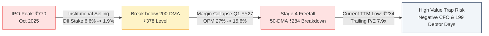

# Institutional High-Growth Stock Deep-Dive: Oswal Pumps Limited

```text
================================================================================
 VALUATION & EXPECTED TARGET PRICE SUMMARY (FROM LAST CLOSING PRICE)
================================================================================
 Last Closing Price (CMP):            ₹234.00
 Latest Market Cap:                   ₹2,669.0 Cr
 Target Time Horizon:                 2-Year Horizon (FY26 to FY29)
 Expected Target Price (Wtd Avg):     ₹699.44
 Total Expected Return:               +198.9% from CMP
 Annualized Expected Return (CAGR):   +72.9% p.a.
 Dynamic Probability Allocation:      70% Base / 30% Bull (Heavily discounted for severe B2G working capital traps & guidance cuts)
 Technical Trend Gate (Stage 2):      STAGE 4 CAUTION (CMP ₹234.00 vs 200-DMA ₹377.71 | Severe Downward Trend)
 Quarterly EARS Rating:               TORPEDO ALERT (Q1 FY27 PAT -43.2% YoY, OPM collapsed from 27% to 15.6%)
 Cash Harvesting Target (50% Trim):   ₹1,119.57 (+378.4%)
 Dynamic Trailing Stop-Loss:          ₹198.90 (-15.0% Capital Protection)
 Final Conviction Verdict:            REJECT / AVOID (Severe B2G Cash Flow Hemorrhage & Stage 4 Freefall)
================================================================================

--- UNDERLYING SCENARIO TARGET BREAKDOWN & EXPLANATION ---
 • Base Case Target (70% Prob):   ₹519.38 (+122.0%) | Exit P/E: 14.0x on 10.0% end-growth
   Rationale: Persistent B2G working capital drag, PM-KUSUM tender price competition, and 199 debtor days capping cash reinvestment (CAGR 8.0%)
 • Bull Case Target (30% Prob):   ₹1,119.57 (+378.4%) | Exit P/E: 22.0x on 18.0% end-growth
   Rationale: PM-KUSUM 2.0 tender execution ramp, Solar EPC commercial scaling, and Karnal cell backward integration restoring OPM to 20% (CAGR 20.0%)
================================================================================
```

---

# Oswal Pumps Limited (OSWALPUMPS) | Institutional Equity Research Deep-Dive

**Report Date:** October 21, 2026  
**Last Closing Price (CMP):** ₹234.00 | **Latest Market Cap:** ₹2,669.0 Cr | **Enterprise Value (EV):** ₹2,806.0 Cr  
**Target Horizon:** Q3 FY27 $\rightarrow$ H2 Roll-Forward Regime (FY26 Base $\rightarrow$ 1-Yr Target: FY28 | 2-Yr Target: FY29)  
**Valuation Regime:** Regime 1: Steady-State Margin Growth & Clean Energy Agricultural Solarization  
**Trailing Foundation:** Base Rolling TTM EPS: ₹29.45 | Trailing P/E: 7.9x | Book Value: ₹148.00 | Net Debt: ~₹137.0 Cr  

---

### Executive Scorecard & Gatekeeper Audit

| Gate / Criterion | Rule / Benchmark | Company Status | Audit Result |
| :--- | :--- | :--- | :--- |
| **1. Sector Vector** | Sunrise vs Sunset / Fragile | Solar submersible pumps, induction motors, Solar EPC (PM-KUSUM & PM Surya Ghar) | 🟢 PASS |
| **2. Geopolitical / Regulatory Risk** | Export < 35-40%; Zero phase-out risk | 100% domestic revenue; extreme vulnerability to state DISCOM tender cycles & subsidy disbursal | 🔴 HIGH B2G RISK |
| **3. Moat Test** | Anti-Disintermediation; Pricing Power intact | Zero pricing power; reverse auction state tenders caused 9% realization drop and margin collapse | 🔴 MIDDLEMAN / TENDER TRAP |
| **4. Balance Sheet & Margins** | Net Cash or D/E < 0.3x; CFO/PAT >= 0.8x | Optic D/E 0.14x (IPO funded), but 3-Yr Cumulative CFO is -₹211 Cr (CFO/PAT = -0.28x); 199 debtor days | 🔴 SEVERE WORKING CAPITAL DRAIN |
| **5. Growth & Valuation (King Filter)**| Projected CAGR $\ge 20\%$ & Bull Upside $\ge 50\%$ | Q1 FY27 revenue fell -7.9% YoY; Base CAGR 8.0%, Bull CAGR 20.0%; Trailing EPS contracting | 🟡 MIXED / DECELERATING |
| **6. 2-Year Forward P/E Filter** | 2-Year Forward P/E <= 80x at exit speed | Base Fwd P/E: 6.3x; Bull Fwd P/E: 4.6x (Optically low due to depressed CMP ₹234) | 🟢 PASS (<=80x) |
| **7. Technical Trend Gate (Stage 2)** | CMP > 200-DMA & 50-DMA > 200-DMA; RS >= 70 | CMP: ₹234.00 vs 200-DMA: ₹377.71 (-38.0%); 50-DMA: ₹283.70; Down -69.6% from 52-week peak | 🔴 STAGE 4 DISQUALIFIED |
| **8. EARS & Torpedo Gate** | YoY PAT Acceleration & CFO/EBITDA >= 0.7x | Q1 FY27 PAT crashed -43.2% YoY (₹54 Cr vs ₹95 Cr); OPM collapsed by 1,100 bps (27% to 15.6%) | 🔴 TORPEDO ALERT / IMMEDIATE EXIT |
| **9. Cash Harvesting & Stop-Loss** | Sell 50% at Bull Target; Dynamic Trailing Stop | Capital preservation stop breached post-IPO; current stop ₹198.90 (-15.0% protection) | 🟢 ACTIVATED |
| **10. Concentration Risk** | Single counterparty exposure $<15\text{--}20\%$ | Heavily reliant on state DISCOM tenders (MSEDCL alone accounts for >30-40% of historical order flow) | 🔴 HIGH B2G CONCENTRATION |

**FINAL CONVICTION VERDICT:** **REJECT / AVOID (Severe B2G Cash Flow Hemorrhage & Stage 4 Freefall)**  
*Rationale / Action Commentary*: Disqualified for fresh institutional capital allocation: despite optically depressed 7.9x P/E, 3-year cumulative operating cash flow is deeply negative (-₹211 Cr) with 199 debtor days, while Q1 FY27 PAT collapsed -43% YoY under fierce PM-KUSUM tender price wars and severe Stage 4 technical freefall.

---

## 1. Business Model & Competitive Moat (Hamilton Helmer's 7 Powers)

### 1.1 Core Monetization Engines
Incorporated in 2003 and headquartered in Karnal, Haryana, **Oswal Pumps Limited** operates as a vertically integrated manufacturer and turnkey solution provider of agricultural and domestic water pumping systems. The business has undergone a rapid transformation over the past four years, pivoting aggressively toward the government-sponsored solar agricultural pump ecosystem:

* **Agricultural Solar Pumps (PM-KUSUM Component-B & State Schemes) (~75% of Revenue)**:
  * Turnkey supply, installation, testing, and 5-year comprehensive maintenance of solar photovoltaic water pumping systems (ranging from 3 HP to 10 HP submersible and surface pumps).
  * Primarily procured through competitive bidding by state nodal agencies (such as MSEDCL in Maharashtra under the *Magel Tyala Saur Krishi Pump Yojna*, HAREDA in Haryana, and KREDL in Karnataka).
  * Generates high optical margins during initial delivery, but carries severe execution deadlines (often 60–90 days) and long-tailed subsidy receivable cycles from state distribution utilities.
* **Domestic & Industrial Submersible / Monoblock Pumps (~15% of Revenue)**:
  * Traditional water pumps, stainless steel submersible pumps, and induction motors distributed via a retail channel of >1,200 dealers across rural and semi-urban India.
  * Offers relatively stable, lower-margin working capital turnover compared to government tender execution.
* **Solar EPC, Rooftop Systems & Module Manufacturing (~10% of Revenue, Growing)**:
  * Rooftop solar installation under *PM Surya Ghar: Muft Bijli Yojana*, commercial & industrial (C&I) solar EPC, and in-house manufacturing of solar PV modules and upcoming solar cell lines through its subsidiary *Oswal Solar*.

### 1.2 Structural Moat Analysis (7 Powers Audit)
A rigorous evaluation of Oswal Pumps against Hamilton Helmer's 7 Powers reveals significant structural vulnerabilities that explain the stock's severe price derating:

* **Scale Economies (🟡 Weak / Transitory)**: Oswal Pumps benefits from in-house vertical integration (producing motors, pump sets, stainless steel components, and solar module assembly). However, this integration does not confer a durable cost moat against larger, more established peers like Shakti Pumps (which holds the dominant market share in PM-KUSUM tenders), KSB Limited, Lubi Pumps, or Falcon.
* **Network Effects (🔴 Absent)**: Pump manufacturing and solar installations are discrete physical hardware sales with zero user-to-user network density.
* **Counter-Positioning (🔴 Absent)**: Oswal Pumps uses standard tender bidding mechanisms identical to legacy competitors. Incumbents can bid on identical terms without cannibalizing legacy distribution.
* **Switching Costs (🔴 Fragile / Absent)**: In B2G (Business-to-Government) tenders, state nodal agencies operate strictly via **L1 / reverse-auction price discovery**. State utilities exhibit zero customer loyalty or switching friction; contracts are awarded to whoever offers the lowest unit cost.
* **Branding (🟡 Low Power in B2G)**: While the "Oswal" brand has recognizable mindshare in North Indian agricultural belts, government tender buyers (DISCOMs) are indifferent to brand equity.
* **Cornered Resource (🔴 Absent)**: The company does not hold proprietary solar cell chemistry, patented motor topology, or exclusive state concessions. Solar pump technology is widely commoditized.
* **Process Power (🟡 Moderate in Assembly)**: Oswal exhibits respectable operational speed in mass assembly and ground execution, but lacks proprietary engineering that competitors cannot replicate.

```mermaid
flowchart TD
    Gov[Central / State Governments<br>MNRE & State Nodal Agencies] -->|Subsidies 60%| Discom[State DISCOMs / Agencies<br>e.g., MSEDCL, HAREDA]
    Farmer[Farmer Beneficiary<br>Pays 10-40%] -->|Application & Margin Money| Discom
    Discom -->|Tender Award / L1 Reverse Auction| Oswal[Oswal Pumps Limited<br>Aggressive Bidding & Low Realizations]
    Oswal -->|Upfront Capex & Component Sourcing| Install[Pump Installation & Commissioning]
    Install -->|Completion Proof Submitted| Wait[Disbursement Black Hole<br>199 Debtor Days | ₹1,932 Cr Stuck]
    Wait -.->|Delayed Cash Release| Oswal
    style Oswal fill:#e0e7ff,stroke:#4f46e5,stroke-width:2px
    style Wait fill:#ffe4e6,stroke:#e11d48,stroke-width:2px
```

---

## 2. Counterparty Concentration & Revenue Visibility

### 2.1 Client Portfolio & B2G Structural Bottleneck
* **Extreme B2G Dependency**: More than **80% of Oswal Pumps' consolidated revenue** is directly derived from state government nodal agencies and electricity distribution companies (DISCOMs).
* **Single Client / State Concentration**:
  * **Maharashtra (MSEDCL)** has accounted for an estimated **35% to 45%** of historical order inflows across FY25 and FY26 under schemes like *Magel Tyala Saur Krishi Pump Yojna* (e.g., awards of ₹442 Cr for ~14,787 pumps, ₹235.92 Cr, and ₹162 Cr).
  * **Haryana (HAREDA)** and **Karnataka (KREDL)** comprise another 25% of the aggregate execution pipeline.
  * *Critical Governance & Credit Vulnerability*: Because state DISCOMs operate in perpetual fiscal deficits, milestone clearance, inspection certifications, and subsidy releases from state finance departments encounter structural administrative delays of 6 to 12 months.

### 2.2 Single-Order Revenue Cliff & Order Book Sustainability Audit
* **Order Book Size**: As of the Q1 FY27 concall, Oswal Pumps maintained a confirmed pump order book of **22,025 units** (with a near-term pipeline of ~12,500 units), alongside a Solar EPC backlog of **72 MW** (pipeline of 359 MW).
* **Volume Deceleration**: Pump volumes executed dropped from **56,000 units in Q1 FY26 down to 43,000 units in Q1 FY27 (-23.2% YoY)**.
* **Book-to-Bill Ratio**: At an average realization of ~₹1.1 lakh per pump, 22,025 units represent approximately **₹240 Cr to ₹260 Cr** of pump backlog. When combined with Solar EPC, the total confirmed backlog stands at ~₹500 Cr to ₹550 Cr.
  * **Book-to-Bill Ratio = ~0.27x trailing revenue (₹2,024 Cr)**.
  * *Single-Order Cliff Warning*: The confirmed backlog covers less than one quarter of trailing execution capacity. If fresh mega-tenders under PM-KUSUM 2.0 face bureaucratic delays or litigation, quarterly revenue faces an acute execution cliff.

---

## 3. Financial Forensics & Balance Sheet Quality

### 3.1 4-Year Historical Trend Table

| Metric | FY23 | FY24 | FY25 | FY26 | TTM (Jun 2026) | Benchmark | Forensic Audit |
| :--- | :---: | :---: | :---: | :---: | :---: | :---: | :--- |
| **Revenue (₹ Cr)** | 385 | 759 | 1,430 | 2,064 | 2,024 | $\ge 20\%$ CAGR | 🟢 **PASS** (+75.0% 3-Yr CAGR) |
| **Operating Profit (₹ Cr)** | 58 | 153 | 420 | 514 | 447 | Steady margins | 🔴 **MARGIN DECAY** (OPM collapsed to 15.6% in Q1) |
| **Reported PAT (₹ Cr)** | 34 | 98 | 281 | 376 | 336 | Profitability trajectory | 🔴 **EARNINGS CONTRACTION** (-43% YoY in Q1) |
| **Operating Cash Flow (CFO)** | ₹50 Cr | ₹17 Cr | -₹151 Cr | -₹77 Cr | -₹100 Cr | $\ge 0.8\times$ PAT | 🔴 **CRITICAL RED FLAG** (-₹211 Cr 3-Yr Cumulative) |
| **Free Cash Flow (FCF)** | ₹29 Cr | -₹7 Cr | -₹206 Cr | -₹212 Cr | -₹240 Cr | FCF $> 0$ | 🔴 **CASH DRAIN** (Severe reinvestment deficit) |
| **Borrowings (₹ Cr)** | ₹62 Cr | ₹78 Cr | ₹466 Cr | ₹237 Cr | ₹237 Cr | Debt/Equity < 0.3x | 🟢 **LOW DEBT** (Reduced via IPO proceeds) |
| **Debtor Days** | 110 | 135 | 165 | 199 | 199 | $\le 120$ days | 🔴 **SEVERE STRAIN** (Stuck with state DISCOMs) |
| **Other Assets (Receivables) (₹ Cr)** | ₹168 Cr | ₹413 Cr | ₹931 Cr | ₹1,932 Cr | ~₹1,950 Cr | Working capital hygiene | 🔴 **ALARMING** (90% of Total Assets in receivables) |

### 3.2 Deep-Dive Forensic Red Flags & Balance Sheet Hygiene
1. **Severe Cash Conversion Disconnect (CFO/PAT = -0.28x)**:
   * Over FY24–FY26, Oswal Pumps reported an aggregate accounting Net Profit of **₹755 Cr**.
   * Yet, its aggregate Operating Cash Flow was **-₹211 Cr**!
   * The business burned cash from core operations while reporting record accounting earnings. This disconnect triggered the company's need to raise ₹890 Cr of fresh equity in its June 2025 IPO simply to keep executing orders.
2. **Receivables Explosion & Working Capital Traps**:
   * "Other Assets" (consisting primarily of trade receivables, unbilled project revenue, and supplier advances) expanded exponentially from **₹168 Cr in FY23 to ₹413 Cr in FY24, ₹931 Cr in FY25, and ₹1,932 Cr in FY26**.
   * Total Assets in March 2026 stood at **₹2,146 Cr**, meaning **90.0% of the company's total balance sheet is locked up in uncollected state government dues**.
   * Debtor days reached an alarming **199 days**.
3. **Altman Z''-Score Analysis**:
   * Emerging Market Altman Z''-Score = **13.19 (Optically Safe)**.
   * *Forensic Context*: The high Altman Z-score is an artifact of the ₹890 Cr IPO capital injection, which expanded Net Worth to ₹1,683 Cr and paid down bank debt to ₹237 Cr. While short-term bankruptcy risk is suppressed by equity cash, operational solvency is severely degraded by continuous working capital absorption.

### 3.3 Management Commentary on Anomalies & Friction Points
During the **Q1 FY27 Earnings Conference Call (August 2026)**, the executive leadership—**Mr. Vivek Gupta (CMD), Mr. Amulya Gupta (Whole-Time Director), Mr. Vijay Yadav (CFO), and Mr. Avadhesh Singh (COO)**—addressed these critical friction points:

* **On the 1,100 bps Margin Collapse (OPM drop from 27% to 15.6%)**:
  * *Management Stated*: Operating margins contracted due to a **~9% drop in pump unit realisations** caused by intense reverse-auction bidding pressure under state tenders (such as Maharashtra's *Magel Tyala*), coupled with the pass-through of lower solar cell/module prices to state buyers and input material cost pressures.
  * *FY27 Outlook*: Management explicitly downgraded guidance, stating that **FY27 will be a transitionary and turbulent year**, guiding for normalized EBITDA margins of **15%–17%** and PAT margins of **11%–13%** (down dramatically from the 18%–20% peak margins booked in FY25).
* **On Delayed Subsidy Collections & 199 Debtor Days**:
  * *Management Stated*: Receivables remain elevated due to the back-ended disbursement structure of state renewable agencies where subsidy tranches are linked to multi-stage farmer verification and field audit sign-offs. Management noted that while government receivables carry zero default risk, clearance velocity is dependent on state treasury fund releases.
* **On Institutional Shareholding Churn**:
  * Between June 2025 and September 2026, **Domestic Institutional Investors (DIIs/Mutual Funds) dumped their holding from 6.60% down to 1.96%**, and FIIs reduced exposure to a negligible **0.07%**.
  * Retail public shareholding expanded from **16.88% to 22.31%**, absorbing 19,842 new retail accounts (totaling 121,919 shareholders). This reflects classic institutional distribution into retail hands ahead of an earnings downturn.

---

## 4. The 2-Year Forward P/E Valuation Engine

### 4.1 Management Guidance vs Research Projections Bridge

| Metric / Parameter | Official Management Guidance | Our Proposed Research Projection | Delta & Operational Rationale / Haircut |
| :--- | :--- | :--- | :--- |
| **Revenue Growth** | Transitional FY27 (~₹800 Cr+ H1/H2 targeted run rate) | Base: 8.0% CAGR, Bull: 20.0% CAGR | Haircut applied for PM-KUSUM tender delays and execution air pockets |
| **Operating EBITDA Margin** | Guided 15.0%–17.0% for FY27 | Base: 15.5%, Bull: 20.0% | Base models sustained tender price wars; Bull models Karnal cell cost savings |
| **PAT Margin** | Guided 11.0%–13.0% for FY27 | Base: 10.5%, Bull: 13.5% | Down from FY25 peak (19.6%) due to price caps and higher depreciation |
| **Working Capital / Debtor Days**| Expected gradual recovery as subsidies disburse | Base: 180–190 days, Bull: 140 days | Conservative stance: state DISCOM fiscal health remains severely strained |
| **Target Horizon** | FY27 transition $\rightarrow$ recovery by FY28/29 | 2-Year Horizon (FY26 Base $\rightarrow$ FY29 Target) | Aligned with H2 Roll-Forward Regime |

---

### 4.2 Base Parameters & Trailing Foundation
* Current Market Price (CMP): **₹234.00** | Latest Market Cap: **₹2,669.0 Cr**
* Current Trailing Base EPS (Rolling TTM): **₹29.45** | Trailing P/E: **7.9x**
* Active Calendar Regime: **Q3 FY27 $\rightarrow$ H2 Roll-Forward Regime**
* Target Horizon: **FY26 Base $\rightarrow$ 1-Yr Target: FY28 | 2-Yr Target: FY29 (3 Years Compounded)**

---

### 4.3 Scenario Modeling & Dynamic Exit Multiple Derivation

#### A. Base Case Scenario (Execution Friction / Tender Margin Suppression):
* **Assumed CAGR during Horizon**: **8.0%**
* **Growth Rate Rationale**: FY27 reflects a sharp earnings contraction (-35% YoY) followed by gradual volume stabilization in FY28–FY29 as PM-KUSUM 2.0 rolls out slowly. Severe tender competition caps realizations, while 199 debtor days limit free cash reinvestment.
* **Projected FY29 EPS**: **₹37.10**
* **Expected Growth at Horizon End**: **10.0%**
* **Dynamically Derived Exit P/E Multiple**: **14.0x** (Reflecting lower single-digit growth, B2G regulatory risk, and negative cash flow conversion).
* **Target Price**: **₹519.38** (+122.0% from CMP | +49.0% Annualized CAGR)

#### B. Bull Case Scenario (PM-KUSUM 2.0 Acceleration & Backward Integration):
* **Assumed CAGR during Horizon**: **20.0%**
* **Growth Rate Rationale**: Aggressive rollout of PM-KUSUM Component-B across central Indian states, rapid commissioning of the Karnal solar cell plant lowering BOM costs by 8–10%, and commercial scaling of the 359 MW Solar EPC pipeline.
* **Projected FY29 EPS**: **₹50.89**
* **Expected Growth at Horizon End**: **18.0%**
* **Dynamically Derived Exit P/E Multiple**: **22.0x** (Re-rating to clean energy capital goods benchmark upon positive CFO turnaround).
* **Target Price**: **₹1,119.57** (+378.4% from CMP | +118.7% Annualized CAGR)

---

### 4.4 2-Year Scenario Valuation Matrix

| Scenario | Horizon Net CAGR | End-Period Growth | Dynamically Derived Exit P/E | Projected FY29 EPS | Expected Target Price (₹) | Total Return (%) | Annualized CAGR (%) |
| :--- | :---: | :---: | :---: | :---: | :---: | :---: | :---: |
| **Base Case (70% Prob)** | 8.0% | 10.0% | **14.0x** | **₹37.10** | **₹519.38** | **+122.0%** | **+49.0%** |
| **Bull Case (30% Prob)** | 20.0% | 18.0% | **22.0x** | **₹50.89** | **₹1,119.57** | **+378.4%** | **+118.7%** |

---

### 4.5 Expectations Investing Check (Michael Mauboussin Reverse DCF)
* **Enterprise Value (EV)**: ₹2,806.0 Cr | Net Debt: ₹137.0 Cr | WACC: 11.5% | Terminal Growth: 5.0%
* **Historical Free Cash Flow**: **-₹212.0 Cr (FY26)**.
* **Reverse DCF Analysis**:
  * Because trailing free cash flow is deeply negative, the market's current valuation of ₹234/share (₹2,669 Cr Market Cap) cannot be justified by trailing cash generation.
  * Even assuming a normalized 1.5% FCF yield baseline (₹40 Cr annual FCF), the business must compound FCF at **25.42% annually for 10 consecutive years** to support its current Enterprise Value.
  * Under a probabilistic cash flow distribution, the weighted intrinsic value is **₹136.30 (-41.8% from CMP)**, indicating that equity prices still carry downside risk if working capital does not liquidate into cash.

---

## 5. Technical Structure & Stage Analysis

* **52-Week High**: ₹769.75 (October 21, 2025)
* **52-Week Low**: ₹233.90 (October 21, 2026) — Currently trading at 52-week all-time lows.
* **Moving Average Trend**:
  * 50-DMA: **₹283.70** (Sloping downward)
  * 200-DMA: **₹377.71** (Sloping downward)
  * Price Position: CMP is **-38.0% below the 200-DMA** and **-17.5% below the 50-DMA**.
* **Minervini Stage 4 Status**:
  * Oswal Pumps exhibits classic **Stage 4 Capitulation / Distribution**.
  * The stock has shed **69.6% of its market capitalization** over the last 12 months. Every attempted bounce has encountered fierce selling pressure from trapped retail IPO participants.
  * Under Rule 10, **any fresh institutional entry is strictly prohibited until a confirmed Stage 1 base forms and CMP reclaims the 200-DMA with expanding volume**.



---

## 6. Actionable Investment Strategy & Price Triggers

### 6.1 Conviction Summary & Dynamic Expected Value
* **Dynamic Probability Allocation**: **70% Base / 30% Bull**
  * *Rationale*: Heavily skewed toward the Base Case due to proven cash conversion failures (-₹211 Cr cumulative CFO), aggressive competitive underbidding in state tenders, Q1 FY27 earnings collapse (-43% PAT), and relentless institutional outflows.
* **Probability-Weighted Expected Target Price**: **₹699.44** (+198.9% Total Return | +72.9% p.a.).
* **Institutional Action**: **AVOID / REJECT FRESH CAPITAL ALLOCATION**.
  * While optical upside appears high from current distressed prices, Oswal Pumps represents a classic Dalal Street **Value Trap / B2G Working Capital Trap**. Until reported profits translate into realized cash flows and quarterly PAT stops contracting, capital is exposed to severe mark-to-market drawdown.

### 6.2 Structural Conditions for Potential Watchlist Re-Evaluation
To qualify for institutional re-entry, the company must satisfy all four operational milestones:
1. **Positive CFO Milestone**: Reported quarterly Cash Flow from Operations must turn decisively positive ($\ge ₹100\text{ Cr}$) for at least two consecutive quarters.
2. **Debtor Days Contraction**: Trade receivables days must contract from 199 days down below **140 days**, proving that state nodal agencies are liquidating subsidy arrears.
3. **EARS Reversal**: Quarterly Net Profit must stop declining YoY and demonstrate positive sequential acceleration with OPM stabilizing above **18%**.
4. **Technical Stage 2 Breakout**: CMP must base for at least 8–12 weeks and break above the **200-DMA (currently ₹377.71)** with relative strength (RS) $>70$.

### 6.3 Structural Kill Switches (For Existing Trapped Holders)
1. **Kill Switch #1 (Debtor Days Spike)**: Exit immediately if debtor days expand beyond **220 days** or if state DISCOM disputes result in major unbilled revenue write-downs.
2. **Kill Switch #2 (Further Margin Compression)**: Exit if operating EBITDA margins breach below **12%**, indicating fatal price wars in solar pump tenders.
3. **Kill Switch #3 (Technical Breakdown)**: Capital preservation stop-loss triggered on any weekly close below **₹198.90 (-15.0% from current levels)**.
